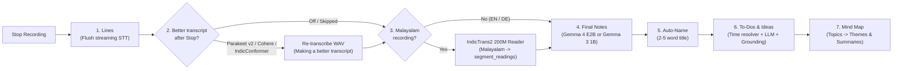
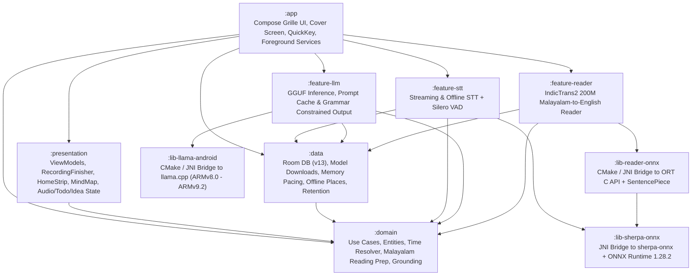

# Satori

**Offline voice recorder, live transcriber, note & to-do extractor, and personal mind map for Android.**

-3DDC84?logo=android&logoColor=white)


Satori (`com.satori`) records voice notes and meetings, transcribes speech on the fly, turns transcripts into structured first-person notes, pulls out scheduled to-dos and ideas, translates spoken English and German, and links recurring subjects across recordings into an on-device mind map.

Every model—voice activity detection, streaming and post-stop speech recognition, the Malayalam-to-English reading bridge, and the instruction-tuned language models—runs locally on the phone. There is no account, no cloud API, and no telemetry. Network access is used only to download model weights from Hugging Face (and a 115 KB vocabulary file if custom recognition words are configured).

The UI (`Grille`) and hardware integration are built specifically for the **Motorola razr 70 plus** across both the unfolded `6.9"` inner display (`1080×2640`) and the `4.0"` external cover screen (`1080×1272`, `480×410 dp`), including its `232 px` physical camera band and double-press hardware power key (`com.motorola.mykey`).

---

## Table of Contents

1. [What Satori Does](#what-satori-does)
2. [Grille UI: Cover Screen & Inner Screen Layouts](#grille-ui-cover-screen--inner-screen-layouts)
3. [How Recording & Preemption Work ("The Recorder Wins")](#how-recording--preemption-work-the-recorder-wins)
4. [The Post-Stop Finishing Pipeline](#the-post-stop-finishing-pipeline)
5. [To-Dos, Reminders, and Ideas](#to-dos-reminders-and-ideas)
6. [Cross-Recording Mind Map](#cross-recording-mind-map)
7. [On-Device Model Lineup & Memory Pacing](#on-device-model-lineup--memory-pacing)
8. [Module Architecture](#module-architecture)
9. [Building from Source](#building-from-source)
10. [Documentation Index](#documentation-index)

---

## What Satori Does

### 1. Immediate Recording & Streaming Transcription
- **Zero-wait microphone capture**: Tapping the docked **Grille** record button (on the inner screen or cover screen) or double-pressing the physical power key opens the microphone and starts writing 16 kHz mono PCM audio to disk immediately (`Getting ready` → `Recording`), even while the speech model is still loading into RAM.
- **Categories & `Record as`**:
  - Ships with four starter categories—**Voice note**, **Meeting**, **Idea**, and **To-do**—plus user-created categories (`Settings → Categories`). Each category maps to a recording style (`SIMPLE_LISTENING`, `SHORT_MEETING`, or `LONG_MEETING`) that controls how its notes are written.
  - You can pick a category before starting or switch it mid-recording via the top `Record as` chip (`Recording as Meeting`).
  - On any finished recording, **Change type** moves the recording to another category and rewrites its notes in that category's style while keeping its title and to-dos.
- **Spoken languages**:
  - **English and German** out of the box via `NVIDIA Parakeet TDT 0.6B v3` (`~670 MB`).
  - **Malayalam** (`മലയാളം`) once the `Malayalam (AI4Bharat)` model (`IndicConformer 120M INT8`, `~140 MB`) is installed in *Advanced settings*. If *Language in Record as* is enabled in *Settings*, you can switch between `English or German` and `Malayalam` from the `Record as` sheet—even mid-recording between two sentences.
- **Custom vocabulary (`Words to recognize`)**: Add names, places, and technical terms (one per line) in *Advanced settings* to boost their recognition in `Parakeet v3` during live recording and *Transcribe again*.

### 2. Live & Post-Stop English ↔ German Translation (`Translate` Mode)
- Selecting **Translate** in `Record as` (`REAL_TIME_TRANSLATION`) transcribes spoken English or German and translates finished sentences into the target language configured under `Settings → Translate into` (`English` or `German`).
- Shows the detected direction under the timer (`German into English`, or `Already English: nothing to translate` when the spoken language already matches the target).
- Replaces the *Notes* tab with a **Translation** tab. Translation runs either live every few sentences (`Translation timing: As you speak`) or in one pass after stopping (`After recording`).

### 3. Structured First-Person Notes
- Unlike generic meetingbots that write third-person summaries (*"The speaker discusses..."*), Satori's prompts (`strings_grille_ai.xml`) and grammar-constrained JSON schemas (`InsightFormat`) write concise first-person notes (*"Call the plumber before 5"*, *"New roof boards cost 80 EUR"*), preserving names, numbers, dates, and places while stripping filler words.
- **Note timing**: For English and German recordings, the local LLM (`Gemma 3 1B` or `Qwen 3.5 0.8B`) can update notes live while you talk (every `10s`–`120s`, default `30s`, once at least 15 new words are spoken) or wait until `Stop` (`After recording`). For Malayalam recordings, notes are always written after `Stop`.
- **Owner-edit protection**: You can edit any transcript line, note bullet, or recording title inline on the details page. Manual edits set provenance flags in Room (`name_by_owner`, `notes_kept_before_redo`, `edited_at`, `kept_before_redo`) so background re-runs never overwrite your edits.

### 4. Audio Playback, Re-Transcription, and Retention Rules
- **Built-in player**: Play/pause, scrub bar, file size and `Compressed` indicator, and **tap any transcript segment** (`Play from here`) to seek directly to that line's timestamp.
- **Transcribe again**: Re-run speech recognition on any saved recording's audio using any installed speech model (**Parakeet v3**, **Parakeet v2**, **Cohere Transcribe**, or **Malayalam (AI4Bharat)**), with an upfront time estimate (`Under a minute`, `About 3 min.`).
- **Retention & AAC compression (`AudioRetentionJob`)**:
  - Raw WAV audio uses `~2 MB/min`. Under `Settings → Keep audio of recordings`, you can configure **Compress older audio** (`After N days`) to transcode older WAV files to AAC/M4A (`~0.25 MB/min`, ~8× smaller, still playable and re-transcribable) and **Delete older audio** (`After N days`) to remove old audio files while keeping transcripts, notes, to-dos, ideas, and mind-map topics.
  - Marking an individual recording with **Keep this audio** on its details menu exempts it from both rules.

### 5. Offline GPS Place Tagging (`places.bin`)
- When `Settings → Save the place` is enabled, Satori captures a single GPS fix when a recording starts and resolves the nearest city or town offline against a bundled GeoNames KD-tree (`app/src/main/assets/places.bin`, e.g., `Köln` or `Near Köln` with accuracy in metres/kilometres). Coordinates never leave the phone, and you can inspect or remove a recording's place at any time.

---

## Grille UI: Cover Screen & Inner Screen Layouts

Satori uses its own typographic design system (**Grille**, documented in [`docs/GRILLE_DESIGN.md`](docs/GRILLE_DESIGN.md)):
- **Dark POLED palette** (`#0A0A0A` canvas, `#F2F0EC` primary ink, `#D94E34` terracotta recording accent) and **Warm Paper light palette** (`#F4F1EA` canvas, `#141413` ink).
- **Typography**: `Doto` dot-matrix display numerals for timers and durations, paired with `Space Grotesk` for body copy, headings, and controls (`tabular-nums` throughout).
- **Zero decorative chrome**: 1 dp hairline rules (`#1F1F1E` dark / `#DCD7CC` light), flat rows, and a permanently docked bottom **Grille** record button with 28 tactile dots.

### Inner Screen (`1080×2640` px, `22:9`)

```text
+--------------------------------------------------+  +--------------------------------------------------+
| Satori                        [Map] [?] [O] [::] |  | <-  Heating repair and rent             [Share] [:]=|
|--------------------------------------------------|  |--------------------------------------------------|
| [ Downloading Cohere Transcribe · 42%    Pause ] |  | Today, 14:20 · 3:42 · Meeting · Near Berlin      |
|                                                  |  | [>] 0:42 / 3:42 ========o----------- 940 KB · M4A|
| TO DO                                2 suggested |  |--------------------------------------------------|
| [ ] Call the plumber before 5       Today, 17:00 |  | TO DO                                            |
| [ ] Send the meter reading          Tomorrow     |  | [ ] Call the plumber before 5       Today, 17:00 |
| See all (4) · 3 ideas, 1 new                     |  |                                                  |
|--------------------------------------------------|  | IDEAS                                            |
| RECORDINGS                                       |  |  o  Bleed the radiators before winter            |
| 03:42  Heating repair and rent         14:20     |  |--------------------------------------------------|
|        Meeting · Boiler pressure dropped...      |  | [ Notes ]              [ Transcript ]            |
| 01:15  Garden shed roof boards         Yesterday |  |  * Boiler pressure dropped below 1 bar           |
|        Finishing up                              |  |  * New expansion vessel costs 140 EUR            |
|--------------------------------------------------|  |  * Plumber can visit Thursday morning            |
|             ( Record as: Voice note )            |  |  Action items                                    |
|  [  . . . . . . .   (*) Record   . . . . . . . ] |  |  * Call the plumber before 5                     |
+--------------------------------------------------+  +--------------------------------------------------+
  Home (To-dos, Ideas link, Recordings, Grille)         Recording Details (Player, To-dos, Ideas, Notes)
```

### Cover Screen (`1080×1272` px, `480×410 dp`, `displayId = 1`)

On the Motorola razr 70 plus external display, the bottom `232 px` (`ROTATION_0`) or top `232 px` (`ROTATION_180` tent mode) is occupied by the physical camera lenses and LED flash (`GrilleCameraBand`). Satori detects the cover display geometry (`isCoverScreen`) and switches to a two-column split layout that keeps all controls clear of the lenses:

```text
+------------------------------------------------------------------+
|  ( Record as: Voice note )                           [Settings]  |
|------------------------------------------------------------------|
|                       |  0:41  "Need to check the boiler         |
|       01 : 18         |         pressure and call the plumber    |
|      Recording        |         before five o'clock today."      |
|                       |                                          |
|  [ (*) Stop        ]  |  0:12  "The radiator in the hallway      |
|                       |         is still cold at the top."       |
|=======================+==========================================|
|   ( O ) Camera Lens     ( O ) Camera Lens      ( * ) Flash       |
|                     232 px Hardware Camera Band                  |
+------------------------------------------------------------------+
  Cover Screen Active Recording (Standard Orientation, ROTATION_0)
```

| Display Context | Resolution | Layout Adaptation | Lock-Screen / Pocket Safety |
| :--- | :--- | :--- | :--- |
| **Inner Screen (`displayId = 0`)** | `1080×2640` px | Full-height vertical stack: `HomeStrip`, **To do** list, **Recordings** list, and docked **Grille** bar (`72 dp`). | When launched over the lock screen via the power key, `Stop` and `Record as` require a long-press (`Hold to stop`, `Hold to change`). |
| **Cover Screen (`displayId = 1`, `ROTATION_0`)** | `1080×1272` px (`480×410 dp`) | Left column holds the `Doto` timer, status line, and **Grille** button; right column scrolls live transcript or recent sessions above the `232 px` bottom camera band. | Single-tap accidental stops are blocked when woken over the lock screen; closing the hinge mid-recording continues capture seamlessly. |
| **Cover Screen (`displayId = 1`, `ROTATION_180`)** | `1080×1272` px (Flipped) | Reserves the `232 px` inset at the **top** of the screen so the UI never collides with the camera rings in tent/stand posture. | Hardware power-key double-press debounced within `1,000 ms` (`QuickKeyRepeatFilter`). |

---

## How Recording & Preemption Work ("The Recorder Wins")

A voice recorder cannot afford dropped audio frames or a multi-second delay while a multi-gigabyte model unloads. Satori enforces a strict preemption rule across `:presentation`, `:domain`, and `:data`: **whenever a recording starts, the recorder wins**.

1. **Instant audio capture**: `RecordingService` opens `AudioRecord` immediately and buffers 16 kHz PCM audio while `SherpaOnnxDataSource` loads `Parakeet v3` (or `IndicConformer` for Malayalam) in the background. Any speech spoken during those first seconds is transcribed as soon as the recognizer comes online.
2. **Immediate background preemption (`ActiveRecorder` & `GatedAiWork`)**:
   - Starting a recording signals `ActiveRecorder`, which immediately cancels or suspends any running background or interactive job:
     - `RecordingFinisher` (post-stop notes, auto-naming, to-dos, mind map, or `Better transcript after Stop`)
     - `:feature-reader` (IndicTrans2 Malayalam-to-English reading pass and `ReadingBackfill`)
     - Interactive details jobs (*Transcribe again*, *Rewrite notes*, *Find to-dos and ideas again*, *Change type*, or *Map this recording*)
   - If *Transcribe again* was interrupted by a new recording, the details page leaves the previous transcript untouched and notes: `Transcribe again stopped for the new recording`.
3. **Hardware Power Key (`QuickKeyActivity`)**:
   - Double-pressing the razr's physical power button launches `com.satori.quickkey.QuickKeyActivity` (`docs/QUICK_KEY.md`), a windowless trampoline that filters accidental bounce presses within `1,000 ms` (`QuickKeyRepeatFilter`) and tells `MainActivity` to start a recording (or stop the active one), waking the screen over the keyguard if locked.

---

## The Post-Stop Finishing Pipeline

When you press **Stop**, the microphone closes, the recording appears at the top of your **Recordings** list on Home, and `RecordingFinisher` processes finished recordings sequentially in `LlmProcessingService` (`FinishingStatusText`):



### Why Malayalam Recordings Have a Dedicated "Reading" Step (`:feature-reader`)
Small 1B-class language models (`Gemma 3 1B`) cannot reliably read Malayalam script directly: on Malayalam transcripts they score near random chance on reading comprehension and frequently echo prompt instructions instead of summarizing what was said. Meanwhile, loading a 3.3 GB model (`Gemma 4 E2B`) on every recording risks Android low-memory kills when device RAM is tight.

Satori solves this in `0.8.0` with a dedicated **reading stage** between *Lines* and *Notes* (`MALAYALAM_FOUNDATION_DESIGN.md`):
- **What the user sees**: A Malayalam recording's **Transcript** tab stays in Malayalam script (`മലയാളം`), and its **Notes**, **Title**, **To-dos**, **Ideas**, and **Mind Map** topics are written in English.
- **How it works under the hood**:
  1. After `IndicConformer` produces the Malayalam transcript segments, `:feature-reader` (`:lib-reader-onnx`) runs **AI4Bharat IndicTrans2 Distilled 200M INT8** (`242 MB` across 3 ONNX graphs on the bundled ONNX Runtime `1.28.2`, beam size 5).
  2. `com.satori.domain.reading` normalizes Malayalam Unicode, runs IndicNLP trivial tokenization and Malayalam-to-Devanagari offset transliteration (since IndicTrans2's shared source vocabulary stores 75,518 Devanagari pieces), encodes via SentencePiece (`model.SRC`), runs beam search across the encoder and KV-cached decoder graphs, and detokenizes the English output (`model.TGT`).
  3. The resulting English readings are stored in Room (`segment_readings`, DB schema v13).
  4. **Notes**, **Auto-naming**, **To-dos & Ideas** (including the deterministic English date/time spotter), and **Mind Map** extraction then read `segment_readings` using `Gemma 3 1B` (or `Gemma 4 E2B`).
  5. **Automatic backfill (`ReadingBackfill`)**: Malayalam recordings that do not yet have `segment_readings` are quietly upgraded in the background when the phone is idle, without overwriting any title, note, or to-do the owner has edited.

---

## To-Dos, Reminders, and Ideas

During step 6 of finishing (`Finding to-dos`), `ExtractTodosUseCase` analyzes the recording for commitments, appointments, requests, and ideas (`strings_grille_todo_ai.xml`):

1. **Deterministic Time Resolution (`TodoTimeResolver` & `MalayalamTodoCues`)**:
   - A 1B language model should never do calendar arithmetic. Before calling the LLM, Satori scans each segment for spoken English and German dates and times (`"Friday at 9"`, `"tomorrow afternoon"`, `"in 20 minutes"`, `"am 14.3. um 10 Uhr"`, plus Malayalam time cues) relative to the exact timestamp when the recording started.
   - Each resolved timestamp is injected under its segment as a token (`T1 = 'Friday at 9' -> Fri 16 Oct 09:00`). The LLM's GBNF grammar only lets it output `"when": "T1"` or `"none"`.
2. **Segment Grounding (`TodoGrounding`)**:
   - Every returned to-do or idea must cite its source segment (`S1`, `S2`, ...) and match words actually spoken in that segment. Uncited or echoed items are discarded.
3. **Open To-Dos vs. Suggested To-Dos (`TodoCapture`)**:
   - **Direct to-dos (`TodoStatus.OPEN`)**: Items where you explicitly asked for a reminder (`explicit`), promised to do something (`commitment`), or recorded inside the **To-do** category appear directly in the **To do** section at the top of Home and schedule an exact Android alarm (`AndroidReminderAlarm`, with **Done** and **Snooze 1 hr** actions on the notification).
   - **Suggested inbox (`TodoStatus.SUGGESTED`)**: Tasks someone else asked for (`asked`), implied tasks (`inferred`), and `appointment` items are held in a compact **`N suggested`** row on Home (`TodoSuggestionsSheet`) where you can **Keep**, **Dismiss**, **Move to ideas**, or **Keep all**.
4. **Ideas (`IdeasScreen`)**:
   - Suggestions or wishes mentioned in a recording (*"there should be an option to..."*, *"it would be nice if..."*)—as well as recordings made in the **Idea** category—are collected on the **Ideas** page (`%d ideas, %d new` on Home, or the lightbulb icon in the top bar).
   - Ideas link back to their source recording and segment, survive even if their recording is later deleted (*Without a recording*), and can be converted into a scheduled to-do with one tap (`Make it a to-do`).

---

## Cross-Recording Mind Map

Step 7 of finishing (`Linking topics`) builds a persistent, on-device map of recurring subjects across all your recordings (`MindMapScreen`, `MapRecordingUseCase`):

- **Two-level hierarchy centered on `You`**:
  - **Themes (`MindNodeKind.THEME`)**: Recurring subjects across your recordings (e.g., *Heating*, *Garden shed*, *Budget*). When multiple recordings touch the same theme, `RefreshThemeSummariesUseCase` writes a 2–4 sentence first-person summary of what is known and decided across those recordings (newest recording wins when facts change).
  - **Topics (`MindNodeKind.TOPIC`)**: What an individual recording said about a theme (1–4 words grounded in that recording's text, plus up to 3 bullet points), linking directly back to the recording.
- **Canvas view & List view**:
  - Switch between the interactive 2D node graph (**Show as map**, with pinch-to-zoom, pan, and **Center** reset) and a structured hierarchical list (**Show as list**).
- **Filtering & Pinning**:
  - Filter by **Core** (themes you pinned with **Keep in Core** plus your most frequent themes), **Recent** (themes active in the last 7 days), or **All**, or search themes by keyword.
  - Older unmapped recordings can be indexed on demand via the **Map N older recordings** banner or per-recording via **Map this recording**.

---

## On-Device Model Lineup & Memory Pacing

Models are downloaded on demand inside the app (`Settings → Models and storage` and `Settings → Advanced`). Every file is verified by byte size and SHA-256 (`ModelChecksums`) before activation.

### Speech Recognition & VAD (`:feature-stt`, `:lib-sherpa-onnx`)

| Model | Role | Languages | Size | Runtime |
| :--- | :--- | :--- | :--- | :--- |
| **Silero VAD** (`silero_vad.onnx`) | Voice activity detection (bundled in APK assets; tunable pause length, max phrase, and threshold) | Language-agnostic | `1.8 MB` | ONNX Runtime `1.28.2` |
| **Parakeet v3** (`PARAKEET_V3`) | Default live streaming speech recognizer & *Transcribe again* (supports custom hotwords via `bpe.vocab`) | English & German (multilingual TDT 0.6B v3 INT8) | `~670 MB` | `sherpa-onnx` |
| **Parakeet v2** (`PARAKEET_V2_EN`) | Optional *Better transcript after Stop* & *Transcribe again* for lower English WER | English | `~660 MB` | `sherpa-onnx` |
| **Cohere Transcribe** (`COHERE_TRANSCRIBE`) | Optional high-accuracy *Better transcript after Stop* & *Transcribe again* | English & German | `~2.9 GB` | `sherpa-onnx` |
| **Malayalam (AI4Bharat)** (`INDICCONFORMER_ML`) | Live streaming, post-stop second pass, and *Transcribe again* for Malayalam speech (`IndicConformer 120M INT8`) | Malayalam (`ml`) | `~140 MB` | `sherpa-onnx` |

### Malayalam Reading Bridge (`:feature-reader`, `:lib-reader-onnx`)

| Model | Role | Direction | Size | Runtime |
| :--- | :--- | :--- | :--- | :--- |
| **IndicTrans2 Distilled 200M INT8** | Internal post-stop reading stage (`segment_readings`) so downstream LLM steps read English instead of raw Malayalam script | Malayalam → English (`mal_Mlym` → `eng_Latn`) | `~242 MB` | ONNX Runtime `1.28.2` C API + SentencePiece |

### Local Language Models (`:feature-llm`, `:lib-llama-android`)

| Model | Setting Name | Role | Size | Quantization |
| :--- | :--- | :--- | :--- | :--- |
| **Gemma 3 1B IT** | **Standard** (default) | Live notes, post-stop notes, auto-naming, to-dos & ideas, live/post-stop EN↔DE translation, and mind map | `~1.0 GB` | `Q8_0` GGUF |
| **Gemma 3 1B IT** | **Efficient** | Lower-memory alternative for live and post-stop tasks | `~650 MB` | `IQ4_NL` GGUF |
| **Qwen 3.5 0.8B** | **Qwen 3.5 0.8B** | Compact alternative model in *Advanced settings* | `~870 MB` | `Q8_0` GGUF |
| **Gemma 4 E2B IT** | **Gemma 4 E2B** | Optional higher-capacity model dedicated to *AI for finished recordings* (post-stop notes, naming, to-dos, and mind map when free RAM permits) | `~3.3 GB` | `Q4_0` QAT GGUF |

### Cooperative Memory Pacing & System-Prompt Caching
Running multi-gigabyte models on a phone without triggering Android's `lmkd` (Low Memory Killer Daemon) or stuttering the UI requires explicit memory governance:
- **Paced Pre-Faulting (`ModelLoadPacing`)**: Custom patches on `llama.cpp` (`0001-load-progress-bytes.patch`, `0002-map-populate-switch.patch`, `0003-mapped-hook.patch`) disable `MAP_POPULATE` and pre-fault GGUF pages at a capped `120 MB/s` (`0 MB/s` while a recording is active) so disk reads never saturate memory bandwidth.
- **Page-Cache & Arena Reclamation**: Releasing a model calls `madvise(MADV_PAGEOUT)` / `posix_fadvise(POSIX_FADV_DONTNEED)` on mapped weight pages and purges native allocator arenas.
- **Live `/proc/meminfo` Guards (`MemoryFloor`, `AnswerFloor`, `ParseRoom`)**: Before loading `Cohere Transcribe`, `Gemma 4 E2B`, or `IndicTrans2`, Satori checks `MemAvailable` against model-specific headroom floors and falls back gracefully (e.g., from `Gemma 4 E2B` to `Gemma 3 1B`) when memory is tight.
- **Disk-Cached System Prompts (`forgetPromptCache`)**: All note, to-do, and mind-map system prompts are static and placeholder-free (`strings_grille_ai.xml`, `strings_grille_todo_ai.xml`, `strings_grille_mindmap_ai.xml`), allowing `:lib-llama-android` to serialize their evaluated KV state to disk once and reload it across sessions without re-evaluating the system prompt on every recording.

---

## Module Architecture

Satori is organized as a multi-module Gradle project with strict dependency boundaries (`:domain` is pure Kotlin with zero Android framework dependencies):



| Module | Responsibility |
| :--- | :--- |
| [`:app`](app) | Jetpack Compose UI (`Grille`), `MainActivity` (`singleTask` cover/inner handoff), `QuickKeyActivity`, `RecordingService`, `LlmProcessingService`, and Hilt DI wiring. |
| [`:presentation`](presentation) | `MainViewModel`, `RecordingFinisher`, `SessionsViewModel`, `SessionDetailsViewModel`, `RecordingAudioViewModel`, `MindMapViewModel`, `IdeasViewModel`, `SettingsViewModel`, and `FirstRunCoordinator` state flows. |
| [`:domain`](domain) | Pure Kotlin business logic: `FinishRecordingUseCase`, `ExtractTodosUseCase`, `TodoTimeResolver`, `TodoGrounding`, `MapRecordingUseCase`, `RefreshThemeSummariesUseCase`, `com.satori.domain.reading` Malayalam preprocessing, and repository interfaces. |
| [`:data`](data) | Room database (`AppDatabase` v13: sessions, segments, `segment_readings`, insights, to-dos, ideas, mind nodes/edges, categories), resumable Hugging Face downloader, `ModelLoadPacing`, `AudioRetentionJob` (WAV→M4A compression & cleanup), and offline `places.bin` geocoder. |
| [`:feature-stt`](feature-stt) | `SherpaOnnxDataSource` managing Silero VAD segmentation, streaming `Parakeet v3` / `IndicConformer` recognition, custom hotword boosting, and offline re-transcription (`Parakeet v2`, `Cohere Transcribe`). |
| [`:feature-reader`](feature-reader) | `OnnxReaderDataSource` driving the 3-session IndicTrans2 200M beam-search translator for Malayalam recordings. |
| [`:feature-llm`](feature-llm) | `LlamaCppDataSource` managing GGUF loading, system-prompt KV disk cache, GBNF grammar enforcement, and token streaming. |
| [`:lib-sherpa-onnx`](lib-sherpa-onnx) | Prebuilt `arm64-v8a` `libsherpa-onnx-jni.so` and `libonnxruntime.so` (`1.28.2`) with Kotlin/JNI bindings. |
| [`:lib-reader-onnx`](lib-reader-onnx) | Native C++ JNI bridge (`reader_jni.cpp`) linking against `:lib-sherpa-onnx`'s `libonnxruntime.so` (`OrtGetApiBase`) and static SentencePiece (`model.SRC` / `model.TGT`). |
| [`:lib-llama-android`](lib-llama-android) | Native CMake build of `llama.cpp` compiling per-microarchitecture ARM64 libraries (`armv8.0` through `armv9.2` with dotprod, i8mm, and FP16 acceleration) loaded dynamically at runtime via `/proc/cpuinfo` detection. |

---

## Building from Source

### Prerequisites
- **JDK 17**
- **Android SDK**: Platform `android-35` (compile/target SDK 35, `minSdk` 29), Build-Tools `34.0.0`
- **Android NDK**: `29.0.13113456` and **CMake** `3.31.6+` (for `:lib-llama-android` and `:lib-reader-onnx`)
- **Git submodules**: `third_party/llama.cpp` and `third_party/sentencepiece` must be initialized before building.

### Clone & Build

```bash
# Run unit tests across all modules (4,000+ unit tests)
./gradlew testDebugUnitTest

# Run Android Lint checks
./gradlew lintDebug

# Build the debug APK
./gradlew assembleDebug
```

The compiled debug APK is written to `app/build/outputs/apk/debug/app-debug.apk`.

---

## Documentation Index

- [`GLOSSARY.md`](GLOSSARY.md) — Domain, hardware, and on-device inference terminology across the codebase.
- [`docs/GRILLE_DESIGN.md`](docs/GRILLE_DESIGN.md) — Complete specification of the `Grille` visual system, color tokens, typography, and cover/inner screen layouts.
- [`docs/QUICK_KEY.md`](docs/QUICK_KEY.md) — Hardware power-key double-press (`com.motorola.mykey`) integration and lock-screen capture behavior.
- [`docs/MODEL_UX_SPEC.md`](docs/MODEL_UX_SPEC.md) — First-run onboarding, background download state machine, storage checks, and `HomeStrip` nudges.
- [`docs/PRIVACY_AND_TERMS.md`](docs/PRIVACY_AND_TERMS.md) — Privacy architecture and local-only data storage guarantees.
- [`docs/THIRD_PARTY_NOTICES.md`](docs/THIRD_PARTY_NOTICES.md) — Licenses and attributions for bundled libraries, fonts, GeoNames data, and downloadable models.
