<p align="center">
  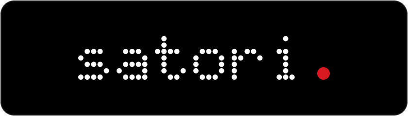
</p>

<h3 align="center">
  Fully offline voice recorder, live transcriber, journal & meeting synthesizer, and personal mind map for Android — powered 100% by on-device AI.
</h3>

<p align="center">
  
  
  
  
  
</p>

---

## Why I Built Satori

I wanted a way to capture thoughts on the go with a quick double-press of a physical hardware key—without unlocking my phone or getting pulled into a screen—and have those notes accumulate over time into a living mind map.

I use Satori every day for **journaling**, **quick thoughts**, **ideas**, **self-development**, **local AI and engineering notes**, and **transcribing meetings**. I didn't have the time to audition a dozen different note-taking apps, and I refused to pay recurring subscriptions just to hand my private voice recordings and personal reflections over to someone else's cloud servers. Instead, I built this.

Every stage of Satori runs **100% offline on the phone**:
- **Live speech recognition** while you walk or sit in a meeting (`NVIDIA Parakeet v3/v2`, `Cohere Transcribe`, `AI4Bharat IndicConformer`, and `Silero VAD` via `sherpa-onnx` and ONNX Runtime `1.28.2`).
- **First-person note synthesis, session naming, to-do extraction, and mind-map linking** via local instruction-tuned language models (`Gemma 3 1B`, `Gemma 4 E2B`, `Qwen 3.5 0.8B`) running on custom-patched `llama.cpp` ARM64 kernels.
- **Neural reading & translation bridges** for live **English ↔ German** conversation translation and an internal **Malayalam → English** reading pass (`AI4Bharat IndicTrans2 200M`) so Malayalam voice notes receive the same structured English notes, reminders, and mind-map connections.
- **Zero accounts, zero cloud servers, zero telemetry.** The network is touched only when downloading model weights directly from Hugging Face.

I am sharing Satori as open source hoping it will be useful to anyone who wants to clone, customize, and build a private voice companion for themselves or for the people they love.

---

## Screenshots & Everyday Use Cases

Built around the **Grille** typographic design system (`Space Grotesk` + `Doto` dot-matrix tabular counters + `#D71921` recording red on `#000000` OLED black), Satori is engineered for both standard Android displays (`1080×2640`) and the **Motorola razr 70 plus** external cover screen (`1080×1272`, `480×410 dp`), including hardware power-key double-press capture over the lock screen and automatic layout clearance around the `232 px` physical camera band.

### 1. External Cover Screen (`1080×1272` · Eyes-Free Capture on the Go)

Double-pressing the physical power key wakes the folded phone straight into recording (`QuickKeyActivity`), keeping all interactive controls clear of the `232 px` hardware camera and flash band in both standard (`ROTATION_0`) and tent/flipped (`ROTATION_180`) postures.

<p align="center">
  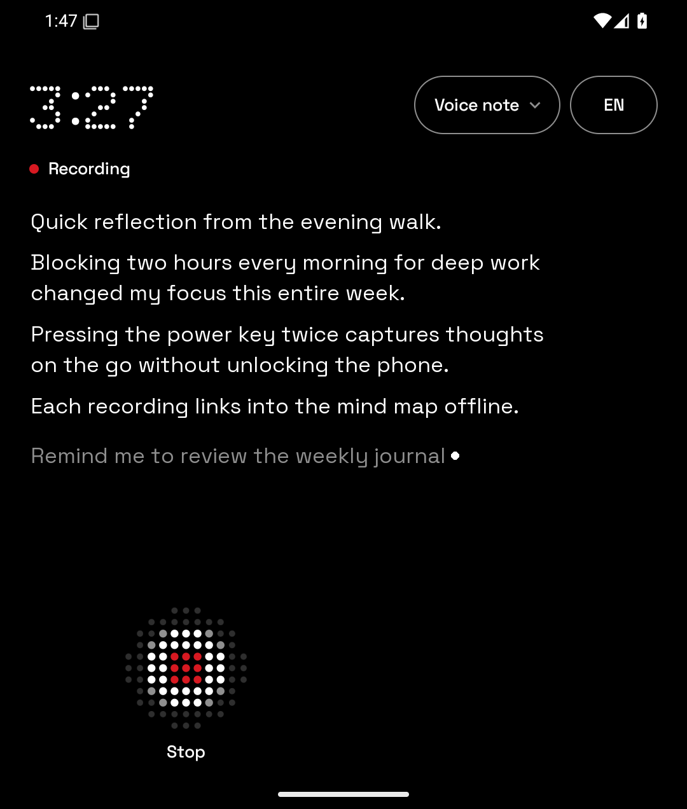
  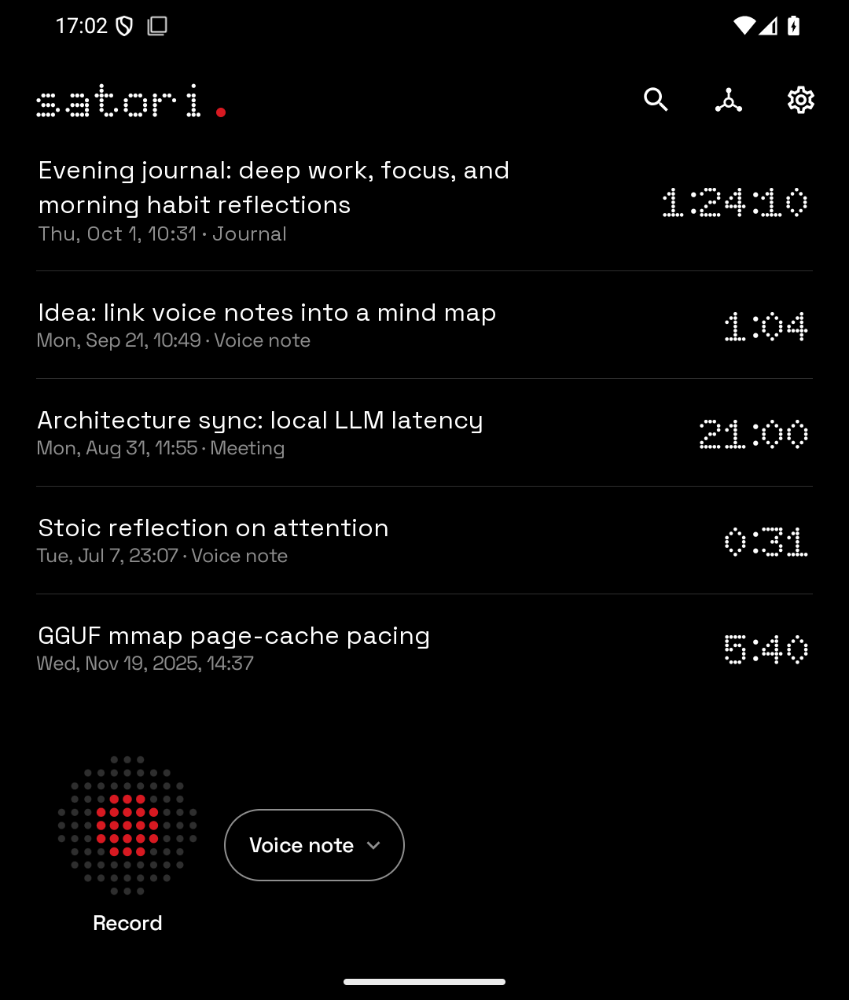
</p>
<p align="center">
  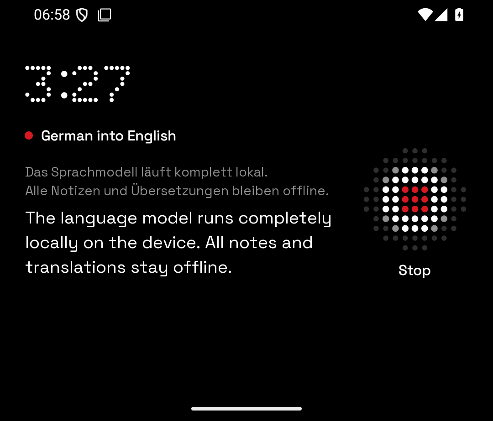
  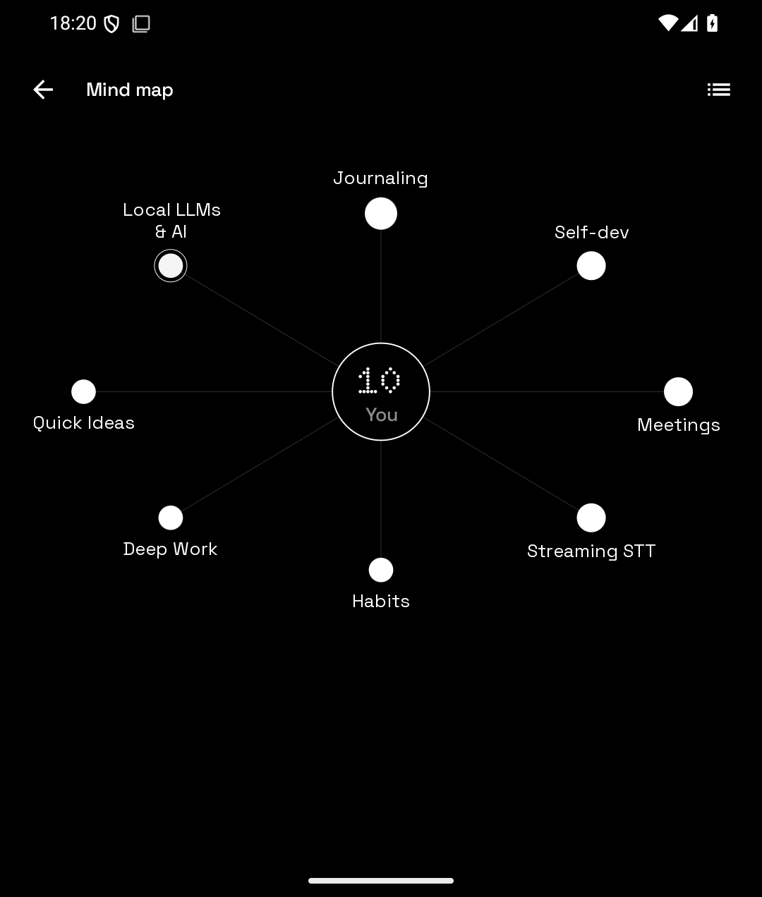
</p>

| Cover View | Use Case & What It Shows |
| :--- | :--- |
| **Quick Power-Key Capture** (`cover-recording.png`) | Capturing an evening walk reflection without unfolding the phone: `Doto` dot-matrix timer, `Voice note` category selector, `EN` language key, streaming `Parakeet v3` transcript, and the tactile **Grille** `Stop` button positioned above the camera band. |
| **Cover Home** (`cover-home.png`) | Browsing recent **Journal**, **Voice note**, and **Meeting** sessions on the folded display with tabular `Doto` durations, search/mind-map/settings actions, and one-tap **Grille** recording. |
| **Live Translation** (`cover-translate.png`) | Real-time **German → English** translation (`Record as → Translate`), pairing the spoken German transcript with live English translations on the cover display. |
| **Cover Mind Map** (`cover-mindmap.png`) | Interactive radial knowledge graph centered on `You` (`10` recordings across `Journaling`, `Local LLMs & AI`, `Self-dev`, `Quick Ideas`, `Meetings`, `Deep Work`, and `Habits`), adapted for the square cover viewport. |

---

### 2. Journaling, Categories, Meetings & Grounded To-Dos (`1080×2640` · Inner Display)

Each recording belongs to a category—**Voice note**, **Meeting**, **Idea**, **To-do**, or custom categories like **Journal**—that governs how the on-device LLM structures your notes and whether spoken action items become scheduled reminders or ideas.

<p align="center">
  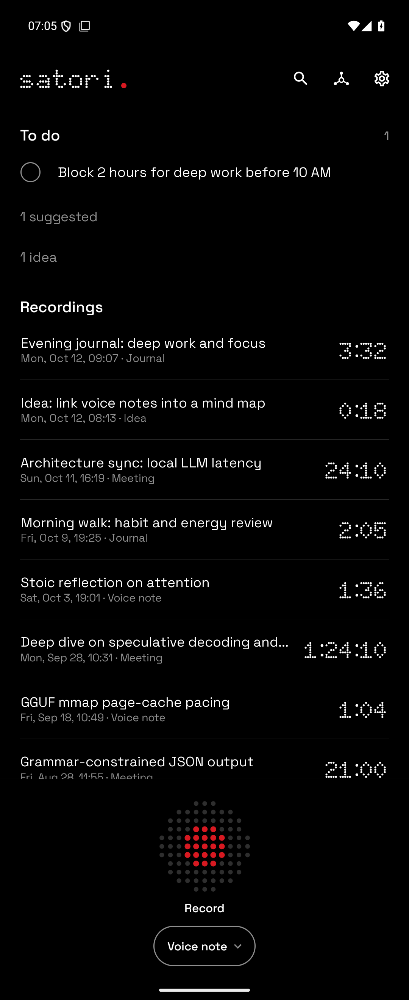
  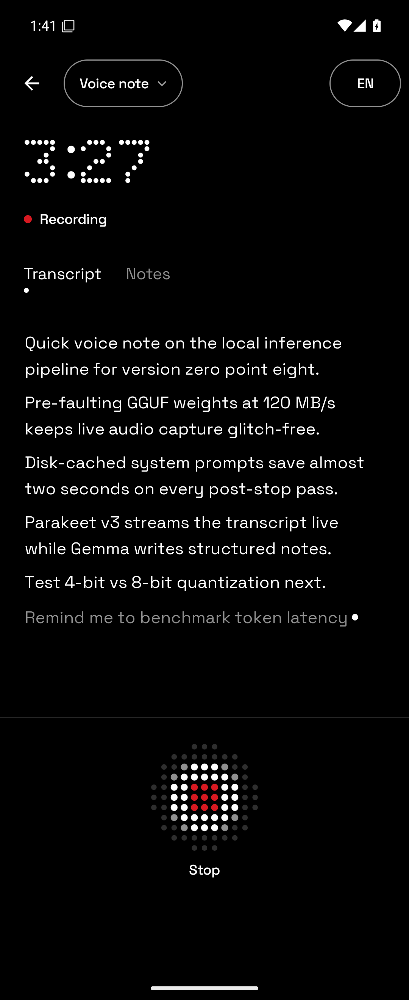
  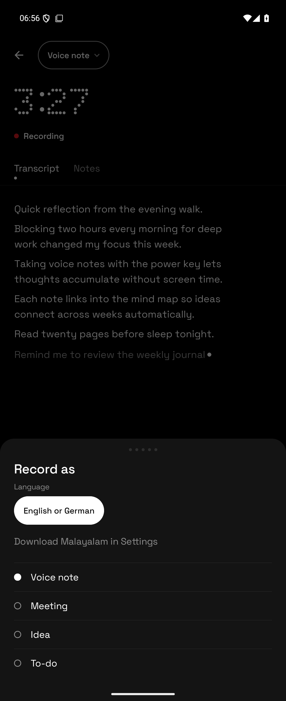
  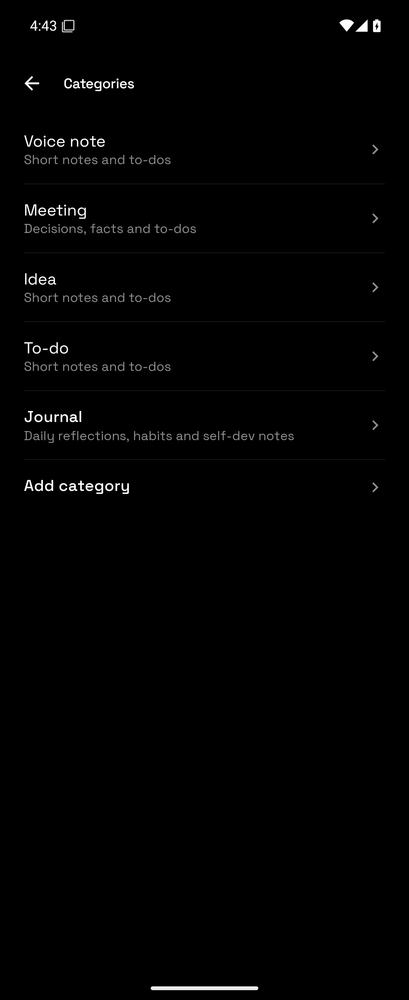
</p>
<p align="center">
  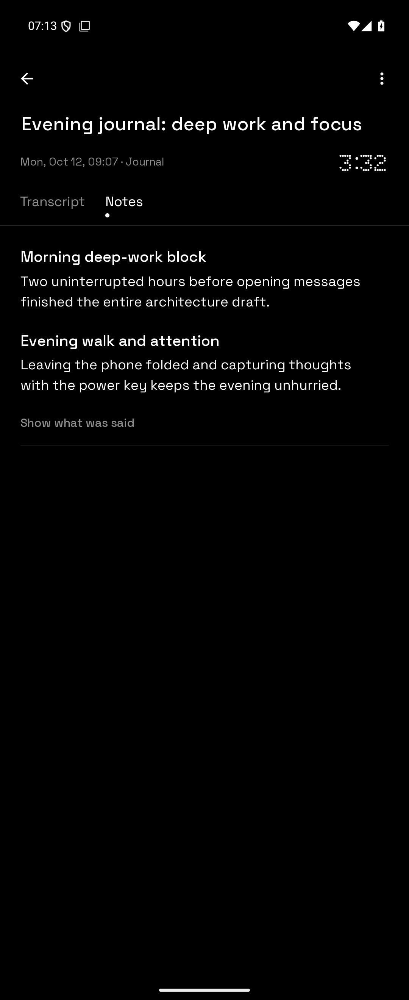
  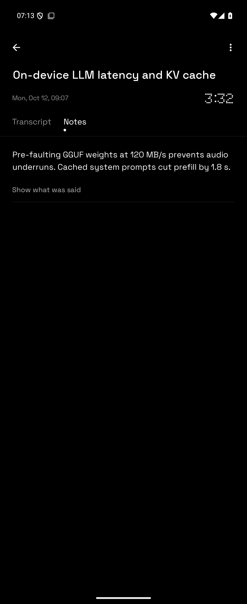
  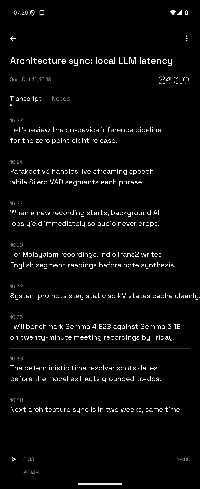
  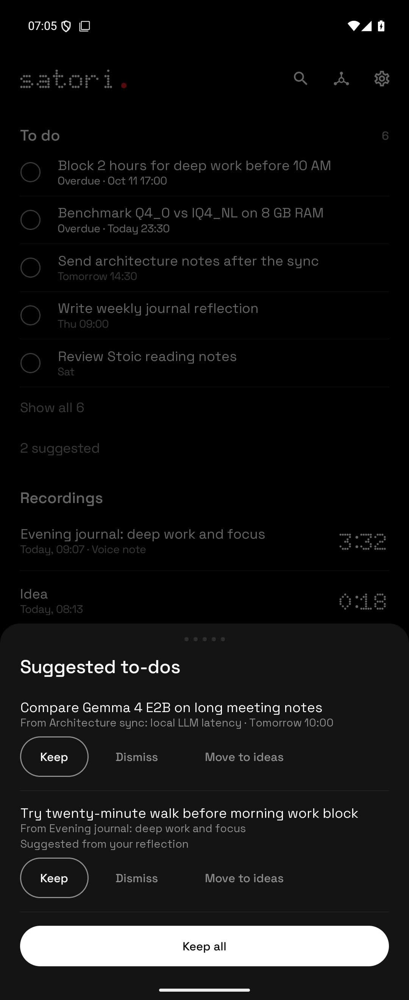
</p>

| Inner View | Use Case & What It Shows |
| :--- | :--- |
| **Home** (`inner-home.png`) | Open **To do** list (`Block 2 hours for deep work before 10 AM`), `1 suggested` inbox link, `1 idea` link, chronological **Recordings** across `Journal`, `Idea`, `Meeting`, and `Voice note`, and the docked **Grille** record bar. |
| **Active Recording** (`inner-recording.png`) | Real-time streaming transcription (`Parakeet v3`) with live partial utterance tracking and instant `Record as` / language switching. |
| **`Record as` Sheet** (`inner-record-as.png`) | Switching category (`Voice note`, `Meeting`, `Idea`, `To-do`, `Translate`) or spoken language (`English or German`, `Malayalam`) before or during a recording. |
| **Categories Manager** (`inner-categories.png`) | Built-in categories plus custom user categories (`Journal — Daily reflections, habits and self-dev notes`), each mapped to a note-synthesis style (`Short notes and to-dos`, `Decisions, facts and to-dos`, or `Sections for a long meeting`). |
| **Journaling & Self-Dev** (`inner-journal.png`) | First-person journal synthesis (`Evening journal: deep work and focus`) distilled from an evening walk reflection, with expandable transcript provenance (`Show what was said`). |
| **Technical & LLM Notes** (`inner-details.png`) | Structured engineering notes (`On-device LLM latency and KV cache`) capturing concrete numbers and trade-offs in first-person voice without generic AI filler. |
| **Meeting Transcript & Player** (`inner-transcript.png`) | Timestamped meeting transcript (`Architecture sync: local LLM latency`) with the built-in audio player (`Play from here` on any line) and file size readout. |
| **To-Dos & Suggested Inbox** (`inner-todos-suggested.png`) | Calendar-grounded open **To do** reminders alongside the **Suggested to-dos** review sheet (`Keep`, `Dismiss`, `Move to ideas`, `Keep all`) for tasks inferred from meetings and journal reflections. |

---

### 3. Personal Mind Map, Theme Nodes, Ideas & Local Models (`1080×2640` · Inner Display)

Over days and weeks, Satori connects your recordings into a two-level knowledge graph (**Themes** and per-recording **Topics**) and gathers spoken wishes into a dedicated **Ideas** collection.

<p align="center">
  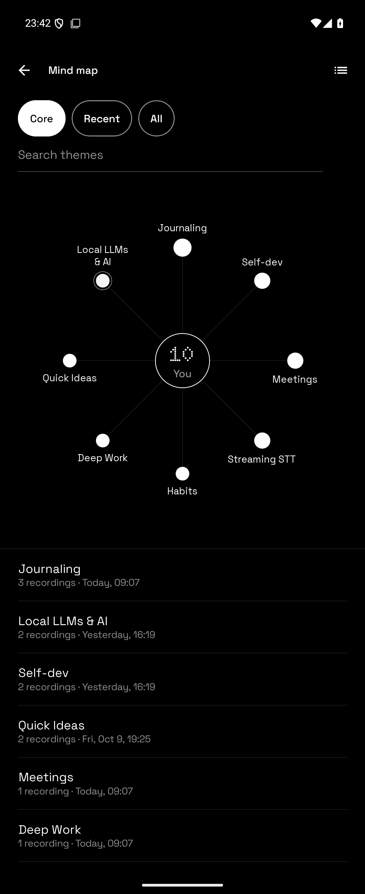
  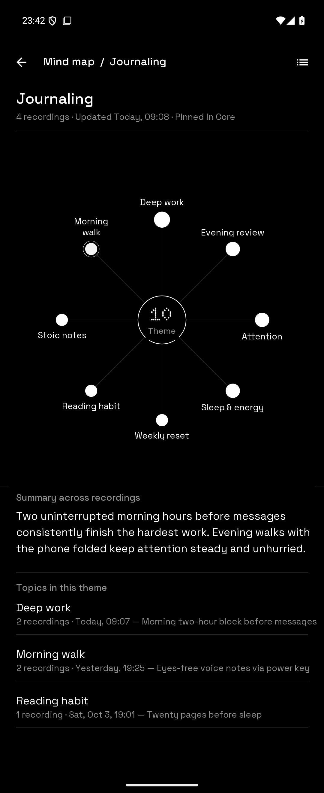
  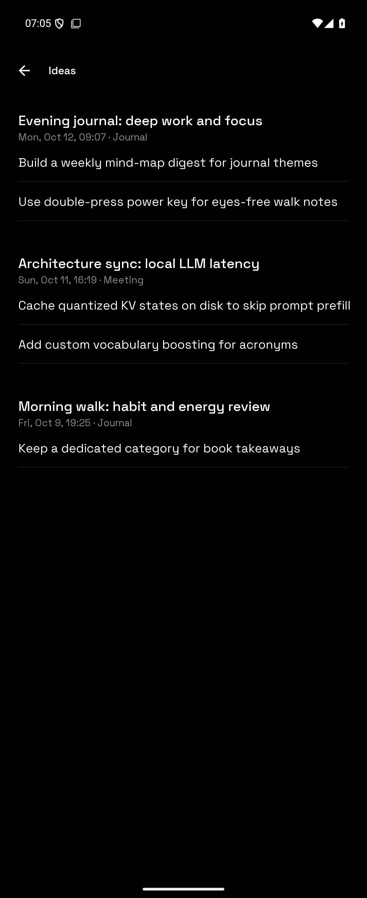
  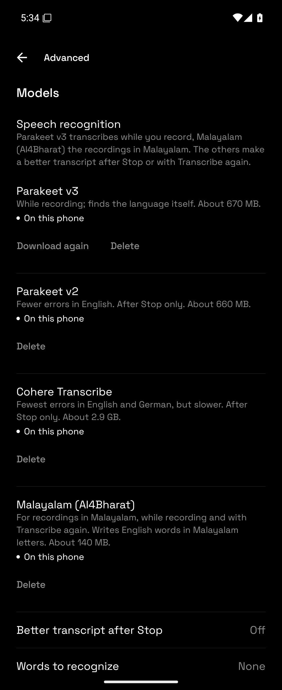
</p>

| Inner View | Use Case & What It Shows |
| :--- | :--- |
| **Mind Map Overview** (`inner-mindmap.png`) | Ego-centric knowledge graph centered on `You` (`Core`, `Recent`, `All` filters, theme search, and recording counts across `Journaling`, `Local LLMs & AI`, `Self-dev`, `Quick Ideas`, `Meetings`, `Deep Work`, `Streaming STT`, and `Habits`). |
| **Theme Node Drill-Down** (`inner-mindmap-node.png`) | Inside the `Journaling` theme node (`4 recordings · Pinned in Core`): radial sub-graph of child topics (`Deep work`, `Morning walk`, `Evening review`, `Attention`, `Sleep & energy`, `Weekly reset`, `Reading habit`, `Stoic notes`), AI-written **Summary across recordings**, and linked **Topics in this theme**. |
| **Ideas Collection** (`inner-ideas.png`) | Every spoken wish or idea extracted across your `Journal` and `Meeting` recordings, grouped by source session and convertible into a scheduled to-do in one tap. |
| **On-Device Model Manager** (`inner-models.png`) | Local model manager (`Parakeet v3`, `Parakeet v2`, `Cohere Transcribe`, `Malayalam (AI4Bharat)`, *Better transcript after Stop*, and custom recognition vocabulary). |

---

## Core Engineering Highlights

- **100% Offline & Private**: Every byte of audio, every transcript segment, every synthesized note, and your entire mind map live in a local Room SQLite database (`AppDatabase` v13) on your phone. Nothing is ever uploaded to a server.
- **"The Recorder Wins" Preemption**: Starting a recording—from the Home screen, the cover screen, or a double-press of the physical power key over the lock screen—opens the microphone immediately and preempts any running background AI task within milliseconds.
- **First-Person Notes, Zero AI Slop**: Generic meeting bots write third-person filler (*"The speaker discusses..."*). Satori's prompts and GBNF grammar schemas force the local LLM to write direct, first-person notes (*"Pre-faulting GGUF weights at 120 MB/s prevents audio underruns"*), verified by `PromptEcho` filters.
- **Calendar-Accurate To-Dos without LLM Math**: Small language models hallucinate calendar arithmetic. Satori spots relative dates and times deterministically (`TodoTimeResolver` for English/German and `MalayalamTodoCues` for Malayalam) relative to the recording's start timestamp, passing verified `T1`/`T2` tokens to the model and grounding every extracted item against the cited segment (`TodoGrounding`).
- **Engineered for Real Phone Memory Limits**: Multi-gigabyte GGUF models are pre-faulted at a paced `120 MB/s` (`0 MB/s` during active recording) with `MAP_POPULATE` disabled, `/proc/meminfo` (`MemAvailable`) safety floors, and immediate page-cache reclamation (`madvise(MADV_PAGEOUT)`) on unload.

---

## Deep Dive: How Satori Works

### 1. Instant Capture, Categories & Hardware Power Key
- **Zero-wait microphone capture**: `RecordingService` opens `AudioRecord` (16 kHz mono PCM) the instant you tap **Record**, buffering audio while the speech recognizer loads in the background so the first words you speak are never lost.
- **Categories & `Record as`**:
  - Ships with four starter categories—**Voice note**, **Meeting**, **Idea**, and **To-do**—plus custom user-defined categories (`Settings → Categories`, such as **Journal**). Each category maps to a recording style (`SIMPLE_LISTENING`, `SHORT_MEETING`, or `LONG_MEETING`) that governs how its notes and action items are structured.
  - Switch categories before recording, mid-recording via the top `Record as` chip, or retroactively on any finished recording via **Change type** (which rewrites the notes in the new category's style while preserving your title and to-dos).
- **Spoken languages & mid-recording switching**:
  - **English and German** out of the box via `NVIDIA Parakeet TDT 0.6B v3` (`~670 MB`).
  - **Malayalam** (`മലയാളം`) via `AI4Bharat IndicConformer 120M INT8` (`~140 MB`). When *Language in Record as* is enabled, you can switch between `English or German` and `Malayalam` mid-recording between two sentences.
- **Custom vocabulary (`Words to recognize`)**: Add names, acronyms, and domain terms (one per line) in *Advanced settings* to boost their recognition in `Parakeet v3` during live capture and *Transcribe again*.
- **Double-press power key (`QuickKeyActivity`)**: Binds to Motorola's hardware double-tap power gesture (`com.motorola.mykey`), debouncing accidental bounce presses within `1,000 ms` (`QuickKeyRepeatFilter`) and waking over the lock screen (`Hold to stop`, `Hold to change` for pocket safety).

### 2. Live & Post-Stop English ↔ German Translation (`Translate` Mode)
- Selecting **Translate** in `Record as` (`REAL_TIME_TRANSLATION`) transcribes spoken English or German and translates finished sentences into the target language configured under `Settings → Translate into` (`English` or `German`).
- Automatically detects the spoken language (`German into English`, or `Already English: nothing to translate` when input and target match).
- Displays a dedicated **Translation** tab, running either live every few sentences (`As you speak`) or in one batch after stopping (`After recording`).

### 3. The 7-Stage Post-Stop Finishing Pipeline (`RecordingFinisher`)
When you press **Stop**, the microphone closes and `RecordingFinisher` processes finished recordings sequentially in `LlmProcessingService` while leaving the recorder free for your next thought:

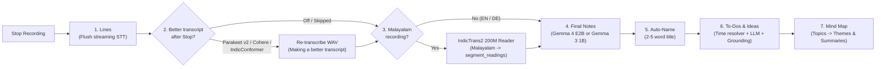

#### How Malayalam Recordings Get Accurate English Notes (`:feature-reader`)
Compact 1B language models (`Gemma 3 1B`) struggle to parse Malayalam script directly, while loading a 3.3 GB model (`Gemma 4 E2B`) on every voice note is too heavy when phone RAM is tight. Satori solves this with a dedicated **internal reading stage**:
- **Visible transcript stays in Malayalam**: Your recording's **Transcript** tab displays the Malayalam script (`മലയാളം`) produced by `IndicConformer`.
- **Under-the-hood IndicTrans2 bridge**: Between *Lines* and *Notes*, `:feature-reader` (`:lib-reader-onnx`) runs **AI4Bharat IndicTrans2 Distilled 200M INT8** (`242 MB`, 3 ONNX graphs on the bundled ONNX Runtime `1.28.2` + SentencePiece `model.SRC`/`model.TGT` + IndicNLP normalization and Malayalam-to-Devanagari offset transliteration, beam size 5) to write internal English readings into Room (`segment_readings`, DB v13).
- **Unified downstream synthesis**: **Notes**, **Auto-naming**, **To-dos & Ideas**, and **Mind Map** topics read `segment_readings`, giving Malayalam recordings the same English notes, date resolution, and grounding quality as English recordings.
- **Idle backfill (`ReadingBackfill`)**: Malayalam recordings that do not yet have `segment_readings` are quietly upgraded when the phone is idle, without overwriting any title, note, or to-do edited by the owner.

### 4. Grounded To-Dos, Exact Reminders & Ideas
- **Open To-Dos vs. Suggested Inbox (`TodoCapture`)**:
  - Explicit reminders (`explicit`), first-person promises (`commitment`), and recordings made in the **To-do** category go straight to your **To do** list on Home (`TodoStatus.OPEN`) and schedule an exact Android alarm (`AndroidReminderAlarm`, with **Done** and **Snooze 1 hr** notification actions).
  - Tasks asked of you by someone else (`asked`), implied tasks (`inferred`), and `appointment` items land in the **`N suggested`** review sheet (`TodoSuggestionsSheet`) where you can **Keep**, **Dismiss**, **Move to ideas**, or **Keep all**.
- **Ideas (`IdeasScreen`)**:
  - Wishes or suggestions mentioned in a recording (*"there should be an option to..."*, *"it would be nice if..."*) and recordings made in the **Idea** category are collected on the **Ideas** page (`%d ideas, %d new` on Home).
  - Ideas link back to their source recording and segment, outlast deleted recordings (*Without a recording*), and convert into scheduled to-dos in one tap (`Make it a to-do`).

### 5. Cross-Recording Mind Map (`MindMapScreen`)
- **Two-level knowledge graph centered on `You`**:
  - **Themes (`MindNodeKind.THEME`)**: Recurring subjects across your recordings (e.g., *Journaling*, *Local LLMs & AI*, *Deep Work*). When multiple recordings link to a theme, `RefreshThemeSummariesUseCase` writes a 2–4 sentence cross-recording summary of what is known and decided (newest recording wins when facts change).
  - **Topics (`MindNodeKind.TOPIC`)**: What an individual recording said about a theme (1–4 grounded words + up to 3 bullet points), linking directly back to the recording.
- **Interactive Canvas & Accessible List**: Toggle between the 2D radial graph (**Show as map**) and a structured list (**Show as list**), filter by **Core** (pinned + top themes), **Recent** (last 7 days), or **All**, and batch-index older recordings via **Map N older recordings**.

### 6. Audio Playback, Re-Transcription, Retention & Offline Places
- **Audio player & seek-to-line**: Play/pause, scrub bar, file size & `Compressed` badge, and tap any transcript line (`Play from here`) to jump playback to that segment's timestamp.
- **Transcribe again**: Re-run speech recognition on any saved recording's audio with any installed model (**Parakeet v3**, **Parakeet v2**, **Cohere Transcribe**, or **Malayalam (AI4Bharat)**).
- **Automatic AAC compression & retention (`AudioRetentionJob`)**: Configure **Compress older audio** (`After N days`, shrinking `~2 MB/min` WAV files to `~0.25 MB/min` AAC/M4A while keeping them playable and re-transcribable) and **Delete older audio** (`After N days`, removing audio while keeping transcripts, notes, to-dos, ideas, and mind-map links). Per-recording **Keep this audio** exempts important recordings.
- **Offline GPS place naming (`places.bin`)**: Optional `Save the place` resolves a recording's starting GPS fix offline against a bundled GeoNames KD-tree (`app/src/main/assets/places.bin`, e.g., `Berlin` or `Near Berlin`) with zero network requests.

---

## On-Device Model Lineup & Memory Governance

Models are downloaded on demand inside the app (`Settings → Models and storage` and `Settings → Advanced`) and verified by byte size and SHA-256 (`ModelChecksums`) before use.

### Speech Recognition & VAD (`:feature-stt`, `:lib-sherpa-onnx`)

| Model | Role | Languages | Size | Runtime |
| :--- | :--- | :--- | :--- | :--- |
| **Silero VAD** (`silero_vad.onnx`) | Voice activity detection (bundled in APK assets; tunable pause length, max phrase, and threshold) | Language-agnostic | `1.8 MB` | ONNX Runtime `1.28.2` |
| **Parakeet v3** (`PARAKEET_V3`) | Default live streaming speech recognizer & *Transcribe again* (supports custom hotwords via `bpe.vocab`) | English & German (multilingual TDT 0.6B v3 INT8) | `~670 MB` | `sherpa-onnx` |
| **Parakeet v2** (`PARAKEET_V2_EN`) | Optional *Better transcript after Stop* & *Transcribe again* for lower English WER | English | `~660 MB` | `sherpa-onnx` |
| **Cohere Transcribe** (`COHERE_TRANSCRIBE`) | Optional high-accuracy *Better transcript after Stop* & *Transcribe again* | English & German | `~2.9 GB` | `sherpa-onnx` |
| **Malayalam (AI4Bharat)** (`INDICCONFORMER_ML`) | Live streaming, post-stop second pass, and *Transcribe again* for Malayalam speech (`IndicConformer 120M INT8`) | Malayalam (`ml`) | `~140 MB` | `sherpa-onnx` |

### Malayalam Reading Bridge (`:feature-reader`, `:lib-reader-onnx`)

| Model | Role | Direction | Size | Runtime |
| :--- | :--- | :--- | :--- | :--- |
| **IndicTrans2 Distilled 200M INT8** | Internal post-stop reading stage (`segment_readings`) so downstream LLM steps read English instead of raw Malayalam script | Malayalam → English (`mal_Mlym` → `eng_Latn`) | `~242 MB` | ONNX Runtime `1.28.2` C API + SentencePiece |

### Local Language Models (`:feature-llm`, `:lib-llama-android`)

| Model | Setting Name | Role | Size | Quantization |
| :--- | :--- | :--- | :--- | :--- |
| **Gemma 3 1B IT** | **Standard** (default) | Live notes, post-stop notes, auto-naming, to-dos & ideas, live/post-stop EN↔DE translation, and mind map | `~1.0 GB` | `Q8_0` GGUF |
| **Gemma 3 1B IT** | **Efficient** | Lower-memory alternative for live and post-stop tasks | `~650 MB` | `IQ4_NL` GGUF |
| **Qwen 3.5 0.8B** | **Qwen 3.5 0.8B** | Compact alternative model in *Advanced settings* | `~870 MB` | `Q8_0` GGUF |
| **Gemma 4 E2B IT** | **Gemma 4 E2B** | Optional higher-capacity model dedicated to *AI for finished recordings* (post-stop notes, naming, to-dos, and mind map when free RAM permits) | `~3.3 GB` | `Q4_0` QAT GGUF |

### Cooperative Memory Pacing & Disk-Cached System Prompts
- **Paced Pre-Faulting (`ModelLoadPacing`)**: Custom patches on `llama.cpp` (`0001-load-progress-bytes.patch`, `0002-map-populate-switch.patch`, `0003-mapped-hook.patch`) disable `MAP_POPULATE` and pre-fault GGUF pages at a capped `120 MB/s` (`0 MB/s` while a recording is active) so disk reads never starve the UI thread or audio capture buffer.
- **Page-Cache & Arena Reclamation**: Releasing a model calls `madvise(MADV_PAGEOUT)` / `posix_fadvise(POSIX_FADV_DONTNEED)` on mapped weight pages and purges native allocator arenas.
- **Live `/proc/meminfo` Guards (`MemoryFloor`, `AnswerFloor`, `ParseRoom`)**: Before loading `Cohere Transcribe`, `Gemma 4 E2B`, or `IndicTrans2`, Satori checks `MemAvailable` against model-specific headroom floors and falls back gracefully (e.g., from `Gemma 4 E2B` to `Gemma 3 1B`) when memory is tight.
- **Disk-Cached System Prompts (`forgetPromptCache`)**: All note, to-do, and mind-map system prompts are static and placeholder-free (`strings_grille_ai.xml`, `strings_grille_todo_ai.xml`, `strings_grille_mindmap_ai.xml`), allowing `:lib-llama-android` to serialize their evaluated KV state to disk once and reload it across sessions without re-evaluating the system prompt on every recording.

---

## Module Architecture

Satori is organized as a 10-module Gradle project with strict Clean Architecture boundaries (`:domain` is pure Kotlin with zero Android dependencies):

```mermaid
flowchart TD
    app[":app\nCompose Grille UI, Cover Screen, QuickKey, Foreground Services"]
    presentation[":presentation\nViewModels, RecordingFinisher, HomeStrip, MindMap, Audio/Todo/Idea State"]
    domain[":domain\nUse Cases, Entities, Time Resolver, Malayalam Reading Prep, Grounding"]
    data[":data\nRoom DB (v13), Model Downloads, Memory Pacing, Offline Places, Retention"]
    feature_stt[":feature-stt\nStreaming & Offline STT + Silero VAD"]
    feature_llm[":feature-llm\nGGUF Inference, Prompt Cache & Grammar Constrained Output"]
    feature_reader[":feature-reader\nIndicTrans2 200M Malayalam-to-English Reader"]
    lib_sherpa[":lib-sherpa-onnx\nJNI Bridge to sherpa-onnx + ONNX Runtime 1.28.2"]
    lib_llama[":lib-llama-android\nCMake / JNI Bridge to llama.cpp (ARMv8.0 - ARMv9.2)"]
    lib_reader[":lib-reader-onnx\nCMake / JNI Bridge to ORT C API + SentencePiece"]

    app --> presentation
    app --> domain
    app --> data
    app --> feature_stt
    app --> feature_llm
    app --> feature_reader

    presentation --> domain
    data --> domain

    feature_stt --> domain
    feature_stt --> data
    feature_stt --> lib_sherpa

    feature_llm --> domain
    feature_llm --> data
    feature_llm --> lib_llama

    feature_reader --> domain
    feature_reader --> data
    feature_reader --> lib_reader
    lib_reader --> lib_sherpa
```

| Module | Responsibility |
| :--- | :--- |
| [`:app`](app) | Jetpack Compose UI (`Grille`), `MainActivity` (`singleTask` cover/inner handoff), `QuickKeyActivity`, `RecordingService`, `LlmProcessingService`, and Hilt DI wiring. |
| [`:presentation`](presentation) | `MainViewModel`, `RecordingFinisher`, `SessionsViewModel`, `SessionDetailsViewModel`, `RecordingAudioViewModel`, `MindMapViewModel`, `IdeasViewModel`, `SettingsViewModel`, and `FirstRunCoordinator` state flows. |
| [`:domain`](domain) | Pure Kotlin business logic: `FinishRecordingUseCase`, `ExtractTodosUseCase`, `TodoTimeResolver`, `TodoGrounding`, `MapRecordingUseCase`, `RefreshThemeSummariesUseCase`, `com.satori.domain.reading` Malayalam preprocessing, and repository interfaces. |
| [`:data`](data) | Room database (`AppDatabase` v13: sessions, segments, `segment_readings`, insights, to-dos, ideas, mind nodes/edges, categories), resumable Hugging Face downloader, `ModelLoadPacing`, `AudioRetentionJob` (WAV→M4A compression & cleanup), and offline `places.bin` geocoder. |
| [`:feature-stt`](feature-stt) | `SherpaOnnxDataSource` managing Silero VAD segmentation, streaming `Parakeet v3` / `IndicConformer` recognition, custom hotword boosting, and offline re-transcription (`Parakeet v2`, `Cohere Transcribe`). |
| [`:feature-reader`](feature-reader) | `OnnxReaderDataSource` driving the 3-session IndicTrans2 200M beam-search translator for Malayalam recordings. |
| [`:feature-llm`](feature-llm) | `LlamaCppDataSource` managing GGUF loading, system-prompt KV disk cache, GBNF grammar enforcement, and token streaming. |
| [`:lib-sherpa-onnx`](lib-sherpa-onnx) | Prebuilt `arm64-v8a` `libsherpa-onnx-jni.so` and `libonnxruntime.so` (`1.28.2`) with Kotlin/JNI bindings. |
| [`:lib-reader-onnx`](lib-reader-onnx) | Native C++ JNI bridge (`reader_jni.cpp`) linking against `:lib-sherpa-onnx`'s `libonnxruntime.so` (`OrtGetApiBase`) and static SentencePiece (`model.SRC` / `model.TGT`). |
| [`:lib-llama-android`](lib-llama-android) | Native CMake build of `llama.cpp` compiling per-microarchitecture ARM64 libraries (`armv8.0` through `armv9.2` with dotprod, i8mm, and FP16 acceleration) loaded dynamically at runtime via `/proc/cpuinfo` detection. |

---

## Building from Source

### Prerequisites
- **JDK 17**
- **Android SDK**: Platform `android-35` (compile/target SDK 35, `minSdk` 29), Build-Tools `34.0.0`
- **Android NDK**: `29.0.13113456` and **CMake** `3.31.6+` (for `:lib-llama-android` and `:lib-reader-onnx`)
- **Git submodules**: `third_party/llama.cpp` and `third_party/sentencepiece` must be initialized before building.

### Build & Verify

```bash
# Initialize native submodules (llama.cpp and sentencepiece)
git submodule update --init --recursive

# Run unit tests across all modules (4,000+ unit tests)
./gradlew testDebugUnitTest

# Run Android Lint checks
./gradlew lintDebug

# Build the debug APK
./gradlew assembleDebug
```

The compiled debug APK is written to `app/build/outputs/apk/debug/app-debug.apk`.

---

## Documentation Index

- [`GLOSSARY.md`](GLOSSARY.md) — Domain, hardware, and on-device inference terminology across the codebase.
- [`docs/GRILLE_DESIGN.md`](docs/GRILLE_DESIGN.md) — Complete specification of the `Grille` visual system, color tokens, typography, and cover/inner screen layouts.
- [`docs/QUICK_KEY.md`](docs/QUICK_KEY.md) — Hardware power-key double-press (`com.motorola.mykey`) integration and lock-screen capture behavior.
- [`docs/MODEL_UX_SPEC.md`](docs/MODEL_UX_SPEC.md) — First-run onboarding, background download state machine, storage checks, and `HomeStrip` nudges.
- [`docs/PRIVACY_AND_TERMS.md`](docs/PRIVACY_AND_TERMS.md) — Privacy architecture and local-only data storage guarantees.
- [`docs/THIRD_PARTY_NOTICES.md`](docs/THIRD_PARTY_NOTICES.md) — Licenses and attributions for bundled libraries, fonts, GeoNames data, and downloadable models.
