<p align="center">
  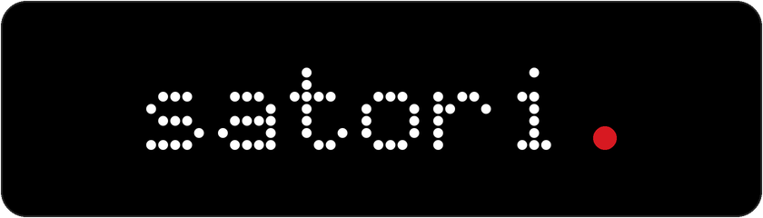
</p>

<p align="center">
  Offline voice recorder, live transcriber, Malayalam-to-English reader, and local note/to-do synthesizer for Android and the Motorola Razr cover display.
</p>

<p align="center">
  
  
  
  
</p>

## Why I Built This

I wanted a fast way to record voice notes, journal thoughts on walks, and transcribe meetings by double-pressing the physical power key on a folded phone without unlocking the screen, paying a monthly subscription, or uploading personal audio to a cloud API.

Satori runs its entire audio and text pipeline locally on the phone:

1. Audio capture opens `AudioRecord` (16 kHz mono PCM) immediately and streams speech recognition through `sherpa-onnx` (`NVIDIA Parakeet TDT 0.6B v3` for English and German, `AI4Bharat IndicConformer 120M` for Malayalam, plus `Silero VAD`).
2. When a recording is in Malayalam, an internal reading pass (`:feature-reader`, `:lib-reader-onnx`) runs `AI4Bharat IndicTrans2 Distilled 200M INT8` on ONNX Runtime + SentencePiece so the visible transcript stays in Malayalam (`മലയാളം`) while downstream 1B language models read clean English segments (`segment_readings`).
3. After you press Stop, a background service (`LlmProcessingService`) runs `Gemma 3 1B`, `Qwen 3.5 0.8B`, or `Gemma 4 E2B` on `llama.cpp` with GBNF grammar constraints to write first-person notes, extract grounded to-dos and reminders, and link recurring topics into a local Room SQLite graph (`AppDatabase` v13).
4. Optional `Translate` mode translates spoken English and German in either direction (`As you speak` or `After recording`).

Network access is used only when downloading model weights from Hugging Face inside `Settings -> Models and storage`. Once models are on disk, the app works in airplane mode.

## Screenshots

### Motorola Razr 70 Plus Cover Screen (`1080x1272`, `displayId = 1`)

Double-pressing the power key wakes `QuickKeyActivity` over the lock screen and keeps controls clear of the `232 px` camera cutout in both upright (`ROTATION_0`) and tent/flipped (`ROTATION_180`) orientations.

<p align="center">
  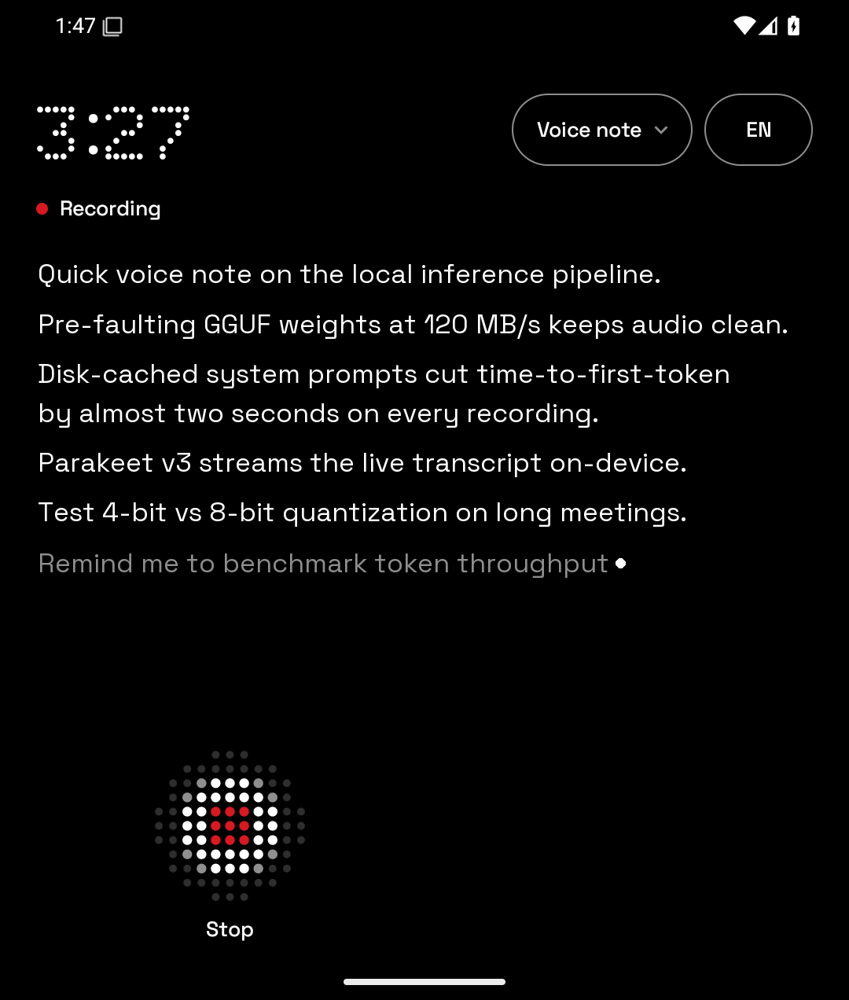
  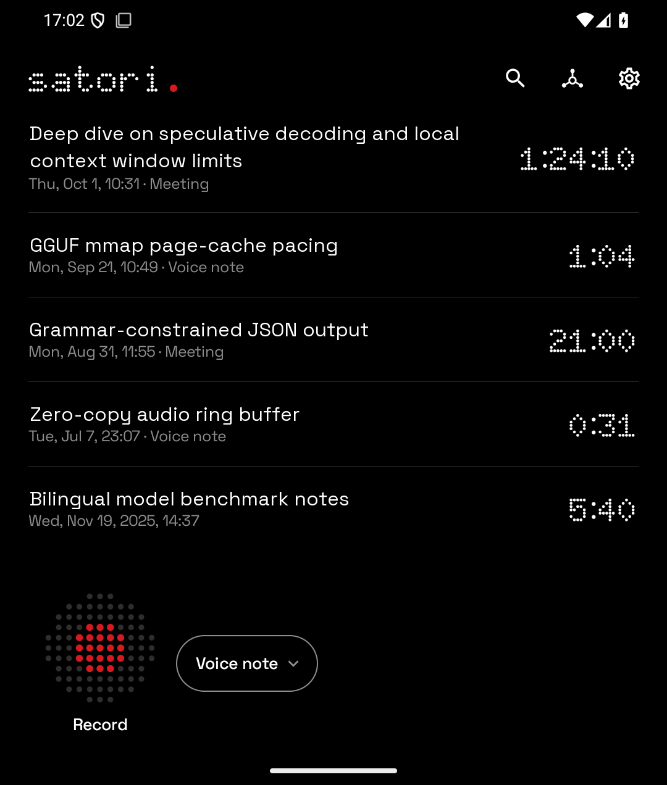
</p>
<p align="center">
  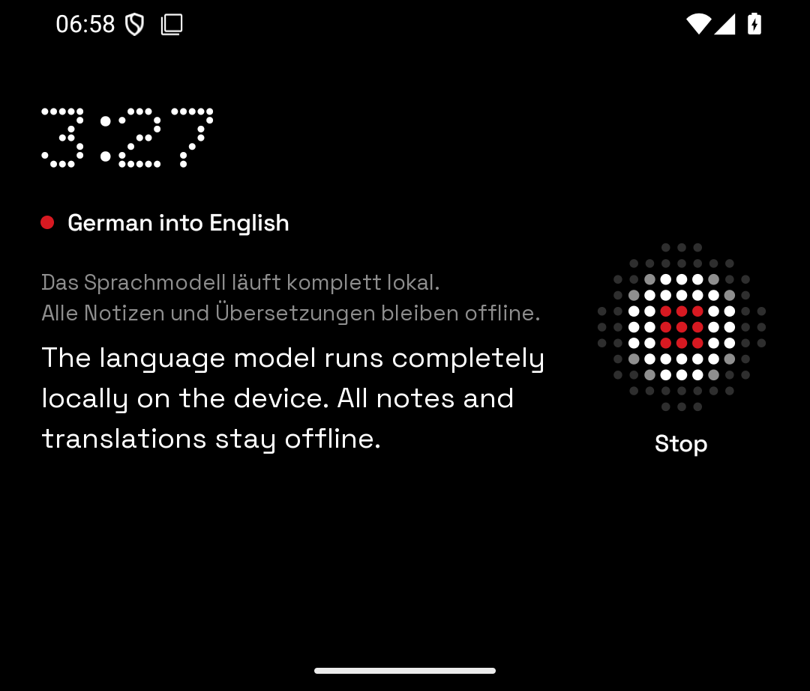
  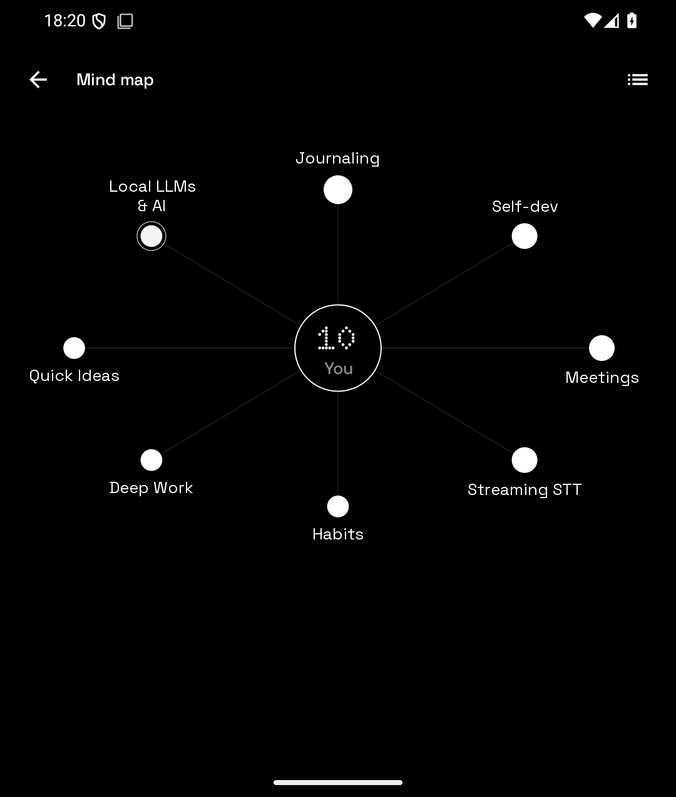
</p>

### Standard / Inner Display (`1080x2640`)

<p align="center">
  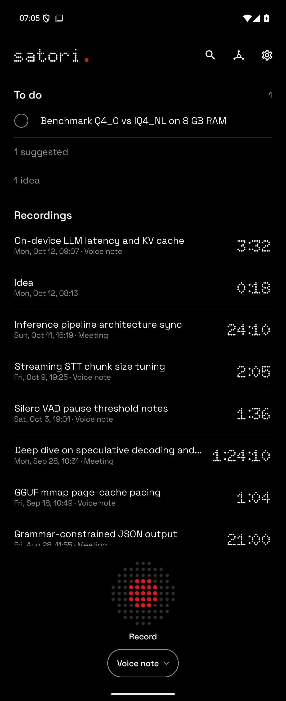
  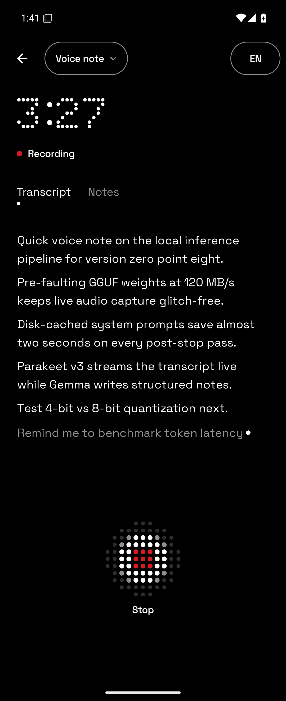
  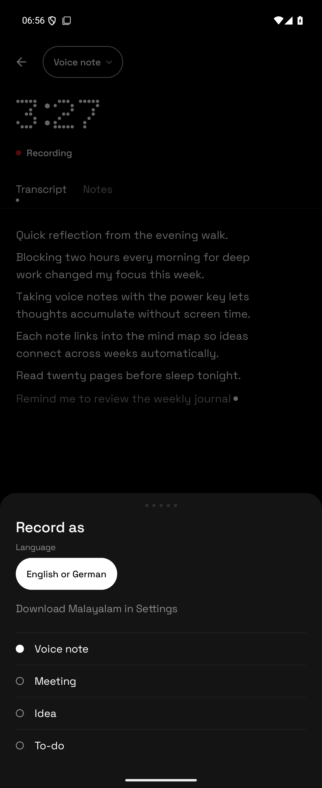
  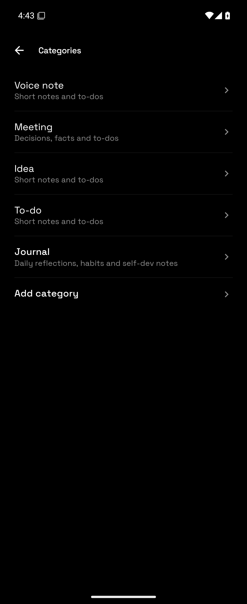
</p>
<p align="center">
  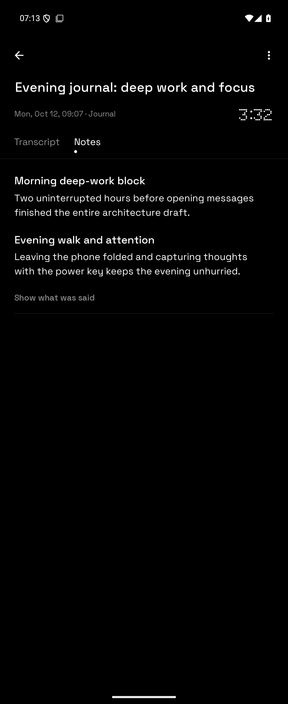
  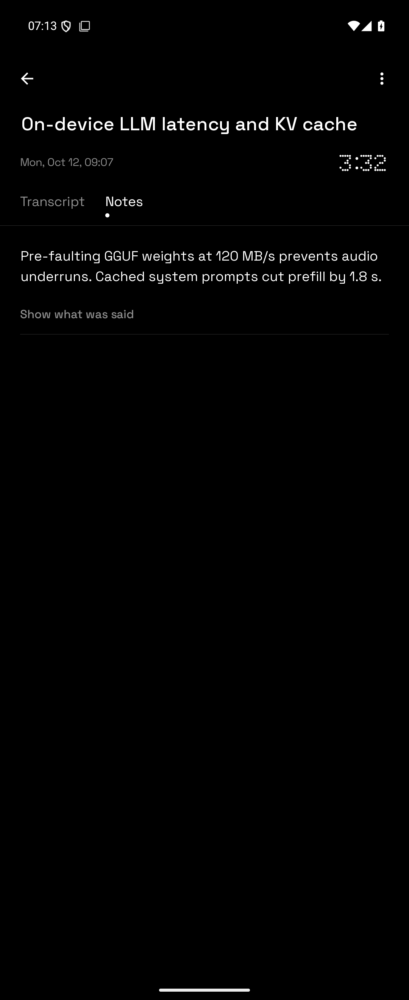
  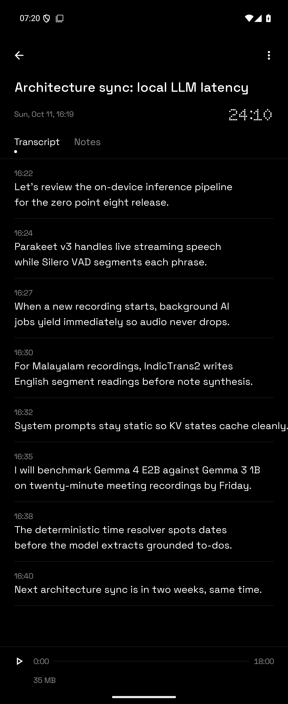
  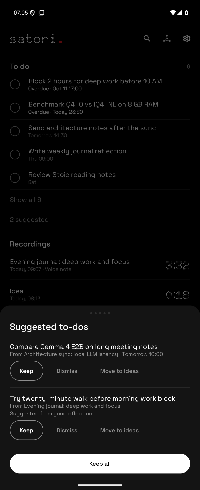
</p>
<p align="center">
  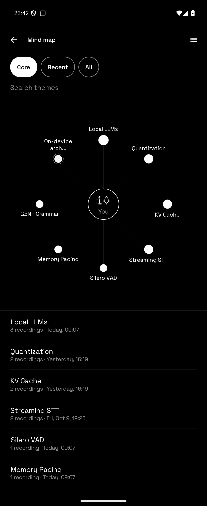
  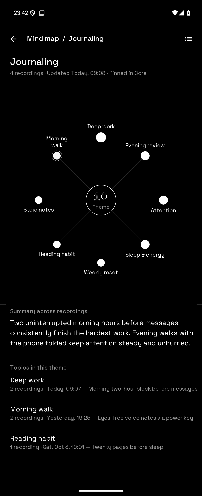
  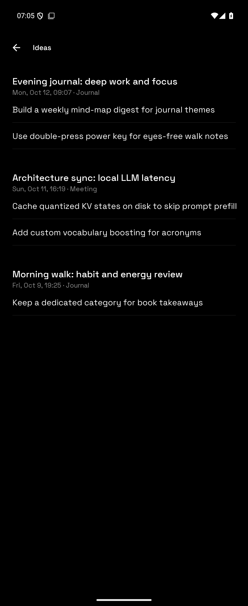
  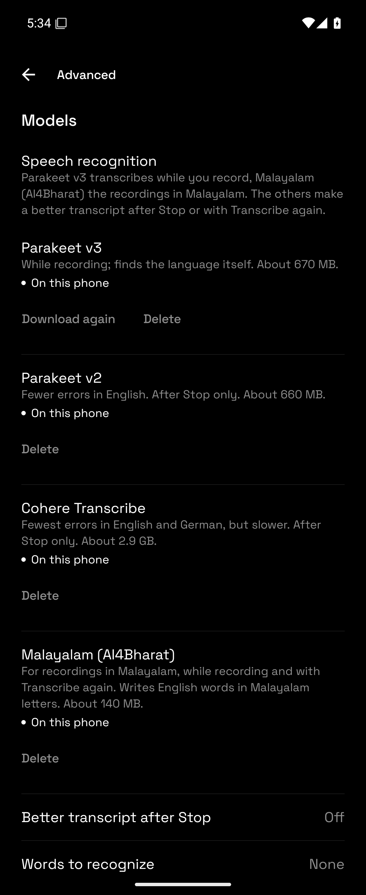
</p>

## Architecture & Design Choices

Satori is split into 10 Gradle modules (`:domain` is pure Kotlin with no Android dependencies):

| Module | Purpose |
| :--- | :--- |
| [`:app`](app) | Jetpack Compose UI (`Grille` theme), cover/inner display routing, `QuickKeyActivity`, `RecordingService`, `LlmProcessingService`, Hilt wiring |
| [`:presentation`](presentation) | ViewModels, `RecordingFinisher` post-stop pipeline, `FirstRunCoordinator`, audio player and mind-map state |
| [`:domain`](domain) | Use cases, deterministic EN/DE/ML relative time parser (`TodoTimeResolver`), segment grounding (`TodoGrounding`), Malayalam text normalization |
| [`:data`](data) | Room database (schema v13), Hugging Face downloader with SHA-256 verification, `ModelLoadPacing`, WAV-to-M4A retention job, offline `places.bin` geocoder |
| [`:feature-stt`](feature-stt) | Streaming and offline speech recognition (`Parakeet v3/v2`, `Cohere Transcribe`, `IndicConformer`) + `Silero VAD` |
| [`:feature-reader`](feature-reader) | 3-graph `IndicTrans2 200M` beam-search translator writing English `segment_readings` for Malayalam sessions |
| [`:feature-llm`](feature-llm) | `llama.cpp` session runner, disk-cached system prompt KV states, GBNF grammar output validation |
| [`:lib-sherpa-onnx`](lib-sherpa-onnx) | Vendored upstream `sherpa-onnx` Kotlin/JNI wrapper and prebuilt `arm64-v8a` `libonnxruntime.so` (`1.28.2`) via Git LFS |
| [`:lib-reader-onnx`](lib-reader-onnx) | C++ JNI bridge linking against `:lib-sherpa-onnx`'s `libonnxruntime.so` and static `SentencePiece` |
| [`:lib-llama-android`](lib-llama-android) | CMake/NDK build of `llama.cpp` across ARM64 microarchitectures (`armv8.0` to `armv9.2` with dotprod/i8mm/FP16 dispatch) |

A few implementation details that mattered on actual hardware:

- Starting a recording always preempts background inference (`ActiveRecorder` / `GatedAiWork`), cancels any running post-stop pass, and opens the mic first while the speech model loads behind an in-memory PCM ring buffer.
- Small 1B models hallucinate calendar math, so `TodoTimeResolver` and `MalayalamTodoCues` resolve relative phrases (`"Friday at 9"`, `"in 20 minutes"`) deterministically against the session timestamp before passing `T1`/`T2` tokens to the LLM, and `TodoGrounding` drops items that do not match words in the cited segment.
- Three small patches on `llama.cpp` (`lib-llama-android/patches/`) disable `MAP_POPULATE` and pace GGUF page-faulting to `120 MB/s` (`0 MB/s` during active capture), check `/proc/meminfo` `MemAvailable` headroom before loading large weights, and call `madvise(MADV_PAGEOUT)` on unload.

## On-Device Models

Models are downloaded on demand in the app and verified by byte length and SHA-256 (`ModelConfig.kt`):

| Model | Task | Languages | Approx. Size | Runtime |
| :--- | :--- | :--- | :--- | :--- |
| `Silero VAD` (bundled in assets) | Voice activity detection | Language-agnostic | `1.8 MB` | ONNX Runtime `1.28.2` |
| `NVIDIA Parakeet TDT 0.6B v3` (`INT8`) | Default live & offline STT | English, German | `670 MB` | `sherpa-onnx` |
| `NVIDIA Parakeet TDT 0.6B v2` (`INT8`) | Optional post-stop STT pass | English | `660 MB` | `sherpa-onnx` |
| `Cohere Transcribe` (`INT8`) | Optional post-stop STT pass | English, German | `2.9 GB` | `sherpa-onnx` |
| `AI4Bharat IndicConformer 120M` (`INT8`) | Live & offline Malayalam STT | Malayalam (`ml`) | `140 MB` | `sherpa-onnx` |
| `AI4Bharat IndicTrans2 Distilled 200M` (`INT8`) | Internal ML-to-EN reading bridge | `mal_Mlym` -> `eng_Latn` | `242 MB` | ONNX Runtime + SentencePiece |
| `Gemma 3 1B IT` (`Q8_0` / `IQ4_NL`) | Default notes, titles, to-dos, EN/DE translation | EN, DE | `1.0 GB` / `650 MB` | `llama.cpp` |
| `Qwen 3.5 0.8B` (`Q8_0`) | Compact alternative LLM | EN, DE | `870 MB` | `llama.cpp` |
| `Gemma 4 E2B IT` (`Q4_0` QAT) | Optional post-stop finishing model on high-RAM phones | EN, DE | `3.3 GB` | `llama.cpp` |

## Project Status & Repository History

`v0.8.0` was published as a clean-history snapshot from an earlier private repository where Satori developed through versions `0.1` to `0.8` (which is why Room migrations start up through schema v13). Upstream `sherpa-onnx` JNI sources in `lib-sherpa-onnx/`, ONNX Runtime C headers in `third_party/`, IndicTrans2 test vocabulary subsets, and generated Room schema JSONs are marked in `.gitattributes` so GitHub language stats reflect the application's own Kotlin and C++ source.

## Building from Source

Prerequisites:
- JDK 17 (`temurin-17` or Homebrew `openjdk@17`)
- Android SDK (`platforms;android-35`, `build-tools;34.0.0`), NDK `29.0.13113456`, and CMake `3.31.6`
- `git-lfs` (`git lfs install`)

```bash
git submodule update --init --recursive
git lfs pull

# Run JVM unit tests, Android Lint, and build debug APK
./gradlew testDebugUnitTest lintDebug assembleDebug
```

The debug APK is written to `app/build/outputs/apk/debug/app-debug.apk`. Full NDK/emulator notes and manual `adb` model sideloading commands are in [`docs/DEV_SETUP.md`](docs/DEV_SETUP.md), power-key setup is in [`docs/QUICK_KEY.md`](docs/QUICK_KEY.md), and codebase terminology is in [`GLOSSARY.md`](GLOSSARY.md).

## Known Limitations

- **ARM64 only (`arm64-v8a`, Android 12+ / `minSdk 31`)**: Native CMake targets and LFS libraries are built for 64-bit ARM devices; x86_64 emulators require building or excluding the native targets as noted in `docs/DEV_SETUP.md`.
- **RAM requirements for optional heavy models**: `Gemma 4 E2B` (`3.3 GB`) and `Cohere Transcribe` (`2.9 GB`) require roughly `8+ GB` of total device RAM to pass `MemAvailable` safety checks; phones with tighter RAM automatically stay on `Gemma 3 1B` and `Parakeet v3`.
- **Foldable cover-screen & power-key specifics**: Cover-screen cutout clearances (`232 px` camera band on `1080x1272`) and the `com.motorola.mykey` double-press power-key hook (configured once via `adb`, no root required) are tuned for the Motorola Razr 70 Plus; standard slab phones use the regular inner UI.
- **CPU inference only**: `llama.cpp` and ONNX Runtime run on ARMv8/ARMv9 CPU SIMD threads (`dotprod` / `i8mm` / `fp16`) rather than vendor-specific Hexagon NPU delegates.

## License & Legal

Licensed under the [Apache License, Version 2.0](LICENSE).
Independent non-commercial open-source project; see [`LEGAL.md`](LEGAL.md) for trademark nominative fair use, clean-room hardware interoperability notices, and German statutory references.
