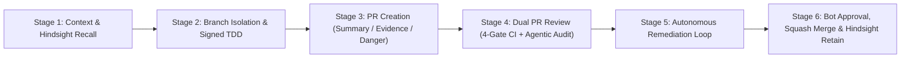

# Fully Autonomous Development Pipeline Specification

This document defines the 6-stage **Fully Autonomous Development Pipeline** governing all Kotlin/Compose application code, native C++/JNI bridges (`llama.cpp`, `sherpa-onnx`, ONNX Runtime + SentencePiece), Room database migrations, and documentation changes in `TinkeringDao/satori`. Every autonomous agent and contributor workflow must execute these stages end-to-end without bypassing branch protection, cryptographic commit verification, or statutory clean-room and local-only privacy invariants.



---

## Stage 1: Context & Hindsight Recall

Before modifying any file or opening a branch:

1. **Hindsight Memory Recall**: Query the persistent Hindsight vector/graph memory bank for prior architectural decisions, model memory pacing invariants, cover-screen layout rules, and legal baselines:
   ```bash
   curl -s -X POST "http://192.168.10.238:9100/v1/default/banks/${HINDSIGHT_BANK}/memories/recall" \
     -H "Content-Type: application/json" \
     -d '{"query": "TinkeringDao satori Android app autonomous pipeline legal baseline"}'
   ```
2. **Mandatory Repository Context**: Read the canonical governance and domain files:
   - [`AGENTS.md`](../../AGENTS.md) and [`CLAUDE.md`](../../CLAUDE.md) — Repository entry points and verification commands.
   - [`LEGAL.md`](../../LEGAL.md) — 8-pillar EU/US statutory interoperability baseline and the `Addendum: German Statutory References (Applicable to Residents of Germany)`.
   - [`SECURITY.md`](../../SECURITY.md) — Threat model, local-only data storage guarantees, and vulnerability disclosure policy.
   - [`docs/agents/domain.md`](domain.md), [`GLOSSARY.md`](../../GLOSSARY.md), [`docs/GRILLE_DESIGN.md`](../GRILLE_DESIGN.md), and [`docs/QUICK_KEY.md`](../QUICK_KEY.md) — Canonical domain vocabulary (`Grille`, `Cover Screen`, `Quick Key`, `"The Recorder Wins"`, `RecordingFinisher`, `segment_readings`, `ModelLoadPacing`, `TodoTimeResolver`, `TodoGrounding`).

---

## Stage 2: Branch Isolation & Signed TDD Implementation

Direct pushes to `main` are blocked by the repository ruleset (`Protect main branch`).

1. **Branch Isolation**: Sync `main` from `origin/main` and create an isolated topic branch using a canonical prefix (`feat/*`, `fix/*`, `chore/*`, `docs/*`, `refactor/*`):
   ```bash
   git fetch origin
   git checkout -B main origin/main
   git checkout -B feat/<topic-name>
   ```
2. **Cryptographic Git Identity & SSH Signing**: Every commit must be authored as `TinkeringDao <203040288+TinkeringDao@users.noreply.github.com>` and signed with an `ED25519` SSH key (`commit.gpgsign=true`, `gpg.format=ssh`, `-S`):
   ```bash
   git config user.name "TinkeringDao"
   git config user.email "203040288+TinkeringDao@users.noreply.github.com"
   git config commit.gpgsign true
   ```
3. **Test-Driven Verification**: Verify all changes locally prior to committing:
   - Run unit tests across all modules via `./gradlew testDebugUnitTest`.
   - Run Android Lint checks via `./gradlew lintDebug`.
   - Verify full native + Kotlin debug assembly via `./gradlew assembleDebug`.
   - Validate offline gazetteer tooling via `python3 -m py_compile tools/gazetteer/build_places.py` and `bash -n gradlew`.

---

## Stage 3: Pull Request Creation

Push the signed branch to `origin` and open a Pull Request against `main` conforming to [`.github/PULL_REQUEST_TEMPLATE.md`](../../.github/PULL_REQUEST_TEMPLATE.md):

- **`## Summary`**: Architectural context, affected Gradle modules (`:app`, `:presentation`, `:domain`, `:data`, `:feature-stt`, `:feature-reader`, `:feature-llm`, `:lib-sherpa-onnx`, `:lib-reader-onnx`, `:lib-llama-android`), and control-flow diagram where applicable.
- **`## Evidence`**: Deterministic `Before` vs. `After` build/test transcripts (`./gradlew testDebugUnitTest lintDebug assembleDebug`) and Cover Screen (`1080×1272`) or Inner Screen (`1080×2640`) screenshots where UI changes occur.
- **`## Merge Danger`**: Explicit reversibility and impact classification:
  - `**Door:** two-way | one-way` (e.g., Room database schema migrations in `AppDatabase` are `one-way`)
  - `**Blast Radius:** local | module | system`

---

## Stage 4: Dual GitHub PR Review (Automated CI Gate + Agentic Spec/Code/Security Review)

Every Pull Request undergoes two complementary review tracks directly on GitHub:

1. **Automated 4-Gate GitHub Actions Workflow ([`.github/workflows/autonomous-pr-review.yml`](../../.github/workflows/autonomous-pr-review.yml)) & Android Build CI ([`.github/workflows/build.yml`](../../.github/workflows/build.yml))**:
   - **Gate 1 (OPSEC & Zero-PII Check)**: Scans the repository working tree to ensure zero personal identifiers, local host directory paths, postal codes, geographic coordinates, or cross-organization identifiers exist.
   - **Gate 2 (Cryptographic Commit Signature Verification)**: Queries `repos/{owner}/{repo}/pulls/{pr_number}/commits` to verify that every commit in the PR has `commit.verification.verified == true`.
   - **Gate 3 (Legal, Governance & Autonomous Spec Integrity)**: Verifies non-empty presence of `LEGAL.md`, `LICENSE`, `SECURITY.md`, `CODE_OF_CONDUCT.md`, `.github/CODEOWNERS`, `AGENTS.md`, `CLAUDE.md`, and `docs/agents/autonomous-pipeline.md`, and confirms `LEGAL.md` retains `Addendum: German Statutory References`.
   - **Gate 4 (Project Syntax & Build Integrity Gate)**: Validates `tools/gazetteer/build_places.py` (`py_compile`), `gradlew` (`bash -n`), and Gradle/Manifest configuration alongside the `Build & Verify` workflow (`./gradlew testDebugUnitTest lintDebug assembleDebug --no-daemon`).
2. **Independent Reviewer Subagent Audit (`superpowers:subagent-driven-development` + `code-review` + `security-review`)**:
   - An independent Reviewer Subagent inspects `gh pr diff <PR_NUMBER>` against the specification, Clean Architecture boundaries, on-device memory safety (`ModelLoadPacing`, `MemAvailable` floors), and security invariants.
   - The Reviewer Subagent posts a structured review directly on the GitHub PR (`gh pr review <PR_NUMBER> --comment --body "..."`) enumerating any concrete findings or improvements required before merge.

---

## Stage 5: Autonomous Remediation Loop

Because the `Protect main branch` ruleset enforces `dismiss_stale_reviews_on_push: true` and `require_last_push_approval: true`:

1. Any finding raised by the Reviewer Subagent or any failure in the 4-Gate CI / Android `Build & Verify` workflows is remediated directly on the PR branch.
2. Remediation changes are committed with an `ED25519` SSH signature (`fix(<scope>): address PR review ...`) and pushed to the PR branch.
3. A structured remediation summary comment is posted on the PR (`gh pr comment <PR_NUMBER> --body "## Autonomous Remediation Complete ..."`), and the 4-Gate and `Build & Verify` workflows automatically re-evaluate the updated `HEAD` commit.

---

## Stage 6: Automated Approval, Squash Merge & Hindsight Retention

1. **Automated GitHub Approval**: Once all 4 CI gates pass on the latest remediated commit and the PR author is verified as `TinkeringDao` on a same-repository branch, `github-actions[bot]` executes `gh pr review <PR_NUMBER> --approve`, satisfying `required_approving_review_count: 1` and `require_last_push_approval: true`.
2. **Squash Merge & Branch Cleanup**: Once both `Autonomous PR Review & Gate` and `Build & Verify` succeed, the approved PR is merged into `main` and the remote feature branch is deleted:
   ```bash
   gh pr merge <PR_NUMBER> --squash --delete-branch
   ```
3. **Hindsight Knowledge Retention**: The merged commit SHA, PR number, and architectural summary are persisted back to the Hindsight memory bank (`POST http://192.168.10.238:9100/v1/default/banks/${HINDSIGHT_BANK}/memories`) so subsequent autonomous runs inherit the updated state.
